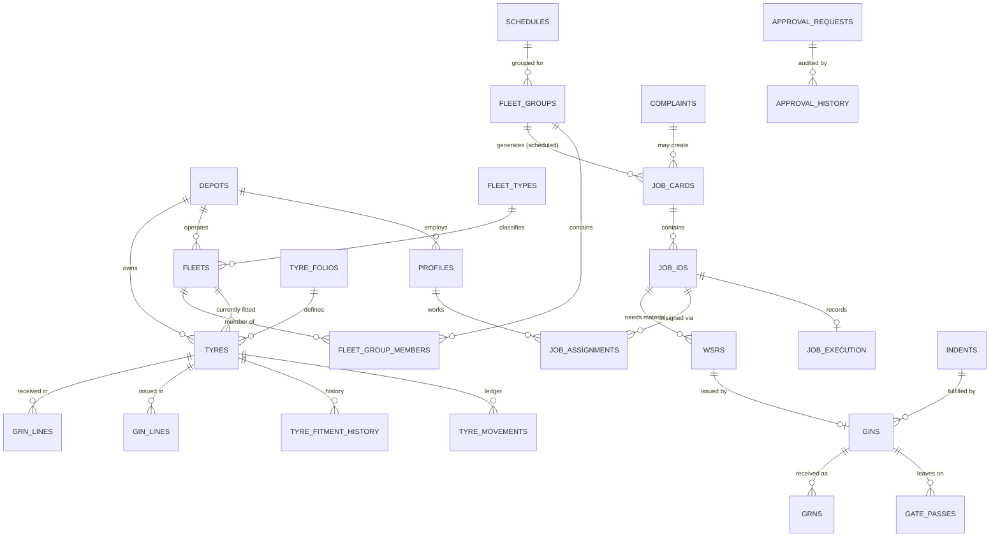

# Database Design — Preliminary

> **SUPERSEDED by Stage 2.** The authoritative design is `stage2-database-schema.md` (127 tables), `stage2-entity-relationship-diagram.md` and `stage2-rls-security-design.md`. Key changes: five roles (AE → AM, Supervisor kept), **all** HO masters go through AM approval, 33 depots + 4 separate org units, Vendor Master added, employee access derived from `employees` (no role/depot on `profiles`), append-only tyre movement history. Kept here for traceability only.

> **Status: preliminary proposal derived from the audit.** No SQL has been written or run, and nothing has been applied to Supabase. In **Stage 2** I will refine this, explain it to you, and only then write migrations. This version is for you to check that the entities, relationships and approval approach match how MTC actually works.

Target: PostgreSQL on Supabase, with Supabase Auth and Row Level Security (RLS).

---

## 1. Design principles

1. **Model the real domain**, not one table. The prototype has about 45 data entities (below), not the 30-odd suggested starting tables.
2. **Depot scoping everywhere.** Every operational row carries `depot_id`; RLS filters by the signed-in user's depot (HO and AE see all).
3. **Master data and transactions are separate.** Masters have `status` (ACTIVE/INACTIVE) and are never hard-deleted.
4. **Maker–checker is data, not code in the screen.** A generic `approval_requests` table stores the *proposed* payload; the live row changes only inside a database function when the checker approves.
5. **Database-side enforcement.** Approval, status transitions and role checks are done by `SECURITY DEFINER` functions and RLS policies; the browser only holds the publishable key.
6. **Every important change is audited** with old and new values.
7. **Prototype vocabulary preserved** (Folio, GIN, GRN, WSR, TLDC, Discout, MIC, TRS…) so the system speaks the users' language.
8. **IDs:** UUID primary keys internally, plus human-readable document numbers (`GIN-MN-2026-0163`) generated server-side.

---

## 2. Entity groups

Notation: `PK` primary key, `FK→` foreign key, `*` required. Every table also has `created_at`, `updated_at`, and (where useful) `created_by`, `updated_by` → `profiles.id`. Columns shown are the *business* columns, not an exhaustive DDL.

### 2.1 Identity and access

| Table | Key columns |
|---|---|
| `profiles` | `id` PK = `auth.users.id`; `employee_code`* (unique, e.g. TIC-1147); `full_name`*; `email`; `role`* (`TIC`,`TM`,`HO`,`AE`,`SUP`); `depot_id` FK→`depots` (null for HO/AE); `phone`; `is_active`; `preferred_language` |
| `roles` | `code` PK; `label`; `landing_route` |
| `user_depot_access` | `profile_id`, `depot_id` (for users who may see more than one depot) |
| `depots` | `id`; `code` (MN, AD, TB…); `name`; `type` (`DEPOT`,`TRS`,`CENTRAL_STORE`,`MIC_UNIT`); `is_active` |

Auth note: Supabase Auth needs an email. The prototype signs in with *Username / Employee ID*, so the login screen will accept the employee ID and map it to a synthetic address on a reserved demo domain. Users are created by an admin seed script run locally (service-role key never in the browser); there is no self-registration. A trigger prevents users changing their own `role`/`depot_id`.

### 2.2 Master data (shared)

| Table | Purpose / key columns | Approval? (prototype) |
|---|---|---|
| `tyre_sizes` | `size_code` (7.50 X 16 …), `status` | direct |
| `makes`, `tyre_models` | make, makers model | via folio |
| `tyre_folios` | folio_no, name, specification, make, model, construction (Radial/Nylon), tube_type, ply, size, group, category, UOM, HSN, expiry, recondition, locations[] , status, `lifecycle_status` | **maker-checker** |
| `tyre_detail_columns` | column definitions (Tyre Detailed Master) | direct |
| `fleet_types` | make, model, type (Small/Standard/Low Floor), status | direct |
| `fleet_type_tyre_sizes` | which sizes fit a fleet type | direct |
| `fleets` | fleet_no (J0264), reg_no, chassis_no, purchase_date, depot_id, model, model_type, fleet_type_id, status, axle_type, air_type, oem_tyre_size, live_odometer, current_route, schedule_km, fc_status, fc_valid_until | direct (air type via request) |
| `routes` | route no/name | direct |
| `tyre_men` | = `profiles` rows with role TIC/TM, plus `experience`, `skills` | register |
| `outsource_employees` | code (OSE-001), name, phone, aadhaar_masked, work_order_type, contractor_name, address, qualification, status | TIC direct |
| `skills`, `employee_skills` | 7 skills; many-to-many | skill add via request |
| `shifts` | code, label (AM/Morning…), start, end, status | direct |
| `job_types` | JOB-001…012, name, fleet_type_id, est_minutes_per_fleet, est_minutes_per_tyre, status | direct |
| `job_required_skills` | job_type ↔ skill | direct |
| `complaint_types` | complaint code, name, category | direct |
| `complaint_required_jobs` | complaint ↔ job_type | direct |
| `reasons` | reason_id, text, used_for[], pauses_schedule, status | direct + depot suggestions |
| `reject_reasons` | GRN/DRN reject reasons | **maker-checker** |
| `wear_patterns` | pattern list | **maker-checker** |
| `qc_checklists`, `qc_checklist_items` | per job type | **maker-checker** |
| `expected_life_km` | tyre_size, new_km, rt1_km…rt5_km | **maker-checker** |
| `psi_norms` | size, construction, position class, air type, psi | direct (conf. C3) |
| `rotation_discout_norms` | cadence days/KM, effective_from; eligible front grades | direct |
| `schedules` | SCH code, name, category, frequency kind, days/particular dates, KM basis & value, work_order_based, outsource_based, due_days, checklist_based, effective_from, status | direct (conf. C2) |
| `schedule_categories`, `schedule_rules`, `schedule_checkpoints`, `schedule_checklist_items`, `schedule_job_map` | the category builder | with schedule |

### 2.3 Tyre inventory (transactional master)

| Table | Key columns |
|---|---|
| `tyres` | `tyre_no` (MTC no), makers_no, folio_id, depot_id (owner), current_location (`FITTED`,`LIVE_STOCK`,`READY_FOR_TRANSIT`,`IN_TRANSIT`,`AT_TRS`,`AT_MIC`,`AT_OTHER_DEPOT`,`RESERVED`), setting_status (`SET`/`UNSET`), grade (`NEW`,`A`,`B`,`C`), condition, retread_level (0–5), received_date, purchase_date, manufactured_date, warranty_upto, current_fleet_id, current_position, fitted_date, km counters (new_km, rt1…rt5_km, running_km, total_km), last_rotation_date, last_discout_date, recent_census_nsd |
| `tyre_accessories` | tube / flap / disc units: kind, no, size, make, condition, stock_status, set_status, tyre_id, fleet_id, position |
| `tyre_movements` | the **ledger**: tyre/accessory, date-time, document type+id (ICRN/GIN/GRN/WSR/Removal/Fitment), inward/outward qty, balance, remarks |
| `tyre_fitment_history` | fleet, position, fitted/removed date, route, kms, days stopped/running, dead km, reason for removal |
| `tyre_retread_stages` | stage, rubber, bonding gum, VC patches, TRS census, RT date, recommended position, achieved km |
| `tyre_repairs` | date, position, cause, action, odometer, repaired_by |
| `tyre_route_usage` | route, fleet, trips, km driven, first/last driven, position |
| `folio_stock_levels` | folio × depot: minimum, maximum, backorder, weighted avg rate |

### 2.4 Scheduling and jobs

| Table | Key columns |
|---|---|
| `fleet_groups` | group name, schedule_id, depot_id, first_schedule_date, `lifecycle_status` (Pending approval/Approved/Inactive) |
| `fleet_group_members` | group_id, fleet_id |
| `schedule_instances` | schedule × group × due date (what the planner shows) |
| `job_cards` | `job_card_no`, depot_id, fleet_id (nullable: "No fleet"), work_category, source (`SCHEDULED`,`COMPLAINT`,`REACTIVE`), complaint_id, due_date, due_shift, status (9 values), instruction, fleet_availability, created_by |
| `job_ids` | `JID-4021`, job_card_id, sequence, job_type, tyre_id, position, assigned_to (profile or OSE), status, started_at, completed_at, depends_on_job_id (Fitment after Setting) |
| `job_assignments` | job_id, assignee, shift, due_date, assigned_by, replaced_by_assignment_id, reason |
| `job_holds` | job_id, reason_id, remarks, held_at, resumed_at |
| `job_execution` | per job_id: removed_at, odometer, nsd_at_removal, tyre_condition, fitted_at, fitment_tyre_id, pressure_after_fitment, entered_on_behalf_by, on_behalf_reason, photos[] |
| `air_inflation_readings` | job_id, tyre/position, found_psi, inflated_psi, target_psi, flagged |
| `inspection_results` | job_id, tyre/position, result, defect complaint |
| `census_readings` | job_id, tyre, groove_count, nsd_mm[], wear_pattern_id |
| `cirt_checklist_answers` | job_card_id, item, answer |
| `final_inspections` | job_card_id, inspector, result (`PASS`,`FAIL`), checklist answers, at |
| `complaints` | `CMPID-0505`, fleet, position, tyre, complaint code, source, raised_by, raised_at, status (`NEW`,`ASSIGNED`,`CLOSED`,`REJECTED`), job_card_id, photo |
| `log_sheet_complaints` | driver name/id, shift, route, run km, shed-in time, wheel, complaint, remarks |
| `removal_orders`, `fitment_orders` | RO-/FO- numbers, job_id, tyre, fleet, position, status |

### 2.5 Workforce

| Table | Key columns |
|---|---|
| `duty_rosters` | week_start, depot_id, status (`DRAFT`,`PENDING_APPROVAL`,`POSTED`,`RETURNED`), submitted_by, approved_by |
| `duty_roster_entries` | roster_id, employee, date, shift or WEEK_OFF/LEAVE |
| `shift_change_requests` | SCR-018, employee, from/to dates, new shift, reason, status |
| `leave_requests` | employee, type (Casual/Sick/Earned), from, to, reason, status |
| `reschedule_requests` | job, prepone/postpone, new date, reason, status |
| `attendance_snapshots` | mock HRMS: employee, date, in/out (read-only) |

### 2.6 Store documents

| Table | Key columns |
|---|---|
| `indents` / `indent_lines` | IND-…, depot (from), request_to, indent type, material type, required_for, status (13 values), lines: folio, qty, issued qty |
| `gins` / `gin_lines` | GIN-…, type, indent_id, from/to unit, destination kind, status, lines: folio, tyre/accessory, requested qty, issued qty, unit price, net amount |
| `grns` / `grn_lines` | GRN-…, source, gin_id, received/accepted/rejected qty, per-line result, reject_reason_id, discrepancy_reason, goes_to |
| `wsrs` / `wsr_lines` | WSR-…, job_id, assigned_to, status, lines: material kind, size, requested qty, issued item no, price |
| `gate_passes` | GP-…, type (outward/inward), source document, vehicle/driver or fleet or employee or person, exit_at, checked_by, status |
| `drns` / `drn_lines` | DRN-…, issued_by, from/to unit, status, lines: tyre |
| `scrap_return_notes` / lines | scrap items & qty |
| `mrns` | material return notes |
| `purchase_indents` / lines | PI-…, type (Supplementary/AWR/Emergency), folio group, indent_to, required_for, lines with consumption history & stock columns |
| `allocation_requests` / lines | allocation type, from, to depot, quantities |

### 2.7 Reports

| Table | Key columns |
|---|---|
| `premature_failure_requests` | request no, tyre, reason, status, linked report |
| `premature_failure_reports` | PFR-…, tyre, bus, failure date, position, skid depth, damage type, fault on, employee, km run, norm km, remaining km, price, loss amount, status |
| `tyre_damage_requests` / `tyre_damage_reports` | request & fill-in of the damage report |

### 2.8 Workflow, audit and system

| Table | Key columns |
|---|---|
| `approval_requests` | `id`; `entity_type` (e.g. `tyre_folio`); `entity_id`; `action` (`CREATE`,`UPDATE`,`DEACTIVATE`); `proposed_payload` jsonb; `previous_payload` jsonb; `status` (`DRAFT`,`PENDING_APPROVAL`,`APPROVED`,`RETURNED`,`REJECTED`,`WITHDRAWN`); `maker_id`; `checker_id`; `remarks`; `submitted_at`; `decided_at`; `depot_id` |
| `approval_history` | request_id, step, actor_id, actor_role, action, comment, at (feeds the Audit Trail modal) |
| `approval_policies` | entity_type, requires_approval (bool), approver_role — **the per-master switch for Q3** |
| `document_status_history` | generic When/Who/Action/Comment for GIN, indent, WSR, DRN, job card… |
| `notifications` | recipient (role/user/depot), type, reference_type/id, message, read_at |
| `audit_logs` | user_id, role, depot_id, action, table, record_id, old_values jsonb, new_values jsonb, at |
| `application_settings` | key/value (demo "today", feature flags) |
| `document_sequences` | per (document type, depot, year/month) counters |
| `app_files` | Supabase Storage metadata for photos |

---

## 3. Relationship overview (core)

---

## 4. Approval engine

**Two mechanisms, because the prototype has two different needs.**

1. **Master changes (`approval_requests`)** — for entities where the prototype shows Draft → Pending → Approved / Returned.
   - HO edits → a row in `approval_requests` holds `proposed_payload`; the **live master row is not touched**.
   - `submit_for_approval(request_id)` → `PENDING_APPROVAL` (and a history row).
   - `approve_request(request_id)` — callable only by role `AE`, and only if `maker_id <> auth.uid()` — applies `proposed_payload` to the live table inside one transaction, sets `APPROVED`, stamps `checker_id` and time, writes `approval_history` and `audit_logs`.
   - `return_request(request_id, reason)` — AE only, reason mandatory; live record unchanged.
   - `withdraw_request(request_id, reason)` — maker only.
   - `approval_policies` decides, per master, whether a change needs approval; for non-approval masters the same function path applies the change immediately and still audits it. This makes Q3 a data setting, not a rewrite.

2. **Operational documents (status columns + transition functions)** — GIN, Indent, WSR, Roster, Fleet Group, Skill request, Purchase Indent, Allocation, DRN, Air-type conversion.
   - Each has its own `status` column and a function per transition (`approve_gin`, `revert_indent`, …) that checks role, depot, current status and mandatory reason, then writes `document_status_history` and `audit_logs`.
   - Illegal transitions (for example Approve on a Draft) raise errors.

Self-approval is blocked by checking `maker_id <> checker_id` inside every approval function, in addition to the role check.

---

## 5. Row Level Security approach

RLS is enabled on every table. Two helpers read the signed-in user's profile:

- `app.current_role()` and `app.current_depot_id()` (stable, `SECURITY DEFINER`, cached per statement).

| Table class | SELECT | INSERT / UPDATE |
|---|---|---|
| Shared masters | all signed-in roles | via approval/maintain functions only; direct writes denied |
| Depot transactions (job cards, indents, GIN, GRN, WSR, gate pass, stock…) | `HO`/`AE` all depots; `TIC`/`SUP` own depot; `TM` only rows where assigned to them (jobs, WSR, roster) | `TIC` own depot; `SUP` approval transitions on own depot; `TM` only update execution rows on jobs assigned to them |
| `profiles` | self; HO/AE all; TIC/SUP own depot | no self-change of `role`/`depot_id`; admin seed only |
| `approval_requests` / history | maker sees own; AE sees all pending; HO sees all | through functions only |
| `audit_logs` | HO/AE read; others none | insert-only via trigger; no update/delete |
| `notifications` | recipient only | system functions |

Principles: deny by default; no policy relies on the front end; the service-role key is never shipped to the browser and is used only in local seed scripts.

---

## 6. Other database concerns

- **Document numbers:** `next_document_no(type, depot, date)` using `document_sequences` with row locking, producing the prototype formats (`GIN-MN-2026-0163`, `WSR-MN-2609-0120`, …). *Q11.*
- **Soft delete:** `status`/`is_active` columns; no `DELETE` policies on masters or documents.
- **Audit:** generic trigger on all business tables writes `audit_logs` with old/new JSON; approval functions add semantic events.
- **Indexes:** FKs, `depot_id`, `status`, `due_date`, `tyre_no`, `fleet_no`, document numbers (unique), partial indexes on pending approvals.
- **Realtime:** enable Supabase Realtime on `job_ids`, `notifications`, `approval_requests` so a Tyre Man sees new jobs and an AE sees new requests without refresh.
- **Storage:** private bucket for photos; path `depot/job/…`; policy by depot/job assignment.
- **Derived values:** tyre km counters, fitted days, idle days, loss amount, compliance %, low-stock flag are computed in views/functions rather than stored, except where history must be frozen (a closed premature-failure report).
- **Migrations:** numbered SQL files in `supabase/migrations/`, applied in order; no destructive change without your approval.
- **Seed data:** scripts under `supabase/seed/`; see §8.

---

## 7. How this maps to the suggested tables in the master prompt

| Suggested | Becomes |
|---|---|
| `profiles`, `roles`, `depots`, `user_depot_access` | same (adds SUP role) |
| `depot_master`, `fleet_master`, `tyre_master`, `employee_master`, `vendor_master` | `depots`, `fleets`, `tyres` (+ `tyre_folios`), `profiles` + `outsource_employees`; `vendor_master` → **not in prototype** (suppliers appear only on Purchase Indent as Central Store) — skipped unless you want it |
| `tyre_size_master`, `tyre_category_master` | `tyre_sizes`; category is a column on `tyre_folios` |
| `approval_requests`, `approval_history` | same, plus `approval_policies` |
| `maintenance_jobs`, `job_assignments`, `work_execution`, `execution_observations`, `inspection_records`, `job_closure` | `job_cards`, `job_ids`, `job_assignments`, `job_execution`, `air_inflation_readings`, `inspection_results`, `census_readings`, `final_inspections` |
| `tyre_fittings`, `tyre_removals`, `tyre_rotations`, `tyre_inspections`, `tyre_movement_records` | `fitment_orders`, `removal_orders`, rotation job_ids, `inspection_results`, `tyre_movements` |
| `maintenance_schedules`, `maintenance_norms`, `scheduling_rules` | `schedules` (+ children), `fleet_groups`, `psi_norms`, `rotation_discout_norms`, `expected_life_km` |
| `notifications`, `audit_logs`, `application_settings` | same |
| *(not suggested)* | indents, GIN, GRN, MRN, SRN, DRN, WSR, gate passes, purchase indents, allocation requests, premature-failure & damage reports, rosters, complaints, folios, ledgers |

---

## 8. Seed-data plan (for your approval)

- **Depots:** all 33 as master data; Mandaveli fully populated; Adyar and Tambaram lightly (Q7); TRS Chrompet, TRS Tondiarpet, Central Store, MIC unit.
- **People:** demo accounts for the five personas; 9 Mandaveli staff + Tyre Men from the prototype; 6 outsource employees (fake data, masked Aadhaar).
- **Fleet & tyres:** 70 Mandaveli fleets with tyres fitted (scaled to the prototype's ~535 tracked tyres); sizes, makes and grades as observed; some tyres At TRS, At MIC, In Transit.
- **Masters:** ~50 folios (various statuses incl. Pending/Returned), 67 complaint types, 10 wear patterns, QC checklists for 11 job types, 12 jobs, schedules SCH001–SCH007, norms, expected-life rows, 4 shifts, reasons.
- **Operations:** one month (Sept 2026): ~290 job cards across all statuses, rounds, complaints, WSRs, GINs/GRNs/gate passes, indents in every status, 2 purchase indents, rosters, premature-failure and damage reports, approval requests in each state (including a returned one).
- All foreign keys valid; identifiers realistic but plainly fictional; **no real personal data**.

---

## 9. Decisions needed for Stage 2

1. **Q3** — which masters carry `requires_approval = true` (default: the five in the prototype).
2. **Q1/Q5/C6/C7** — approver roles for DRN, shift change, leave, prepone/postpone, final inspection.
3. **Q7/Q12** — depot count and demo date for seed data.
4. **Vendors** — add a vendor/supplier master or not.
5. **Login ID** — confirm sign-in by Employee ID mapped to a synthetic email.
