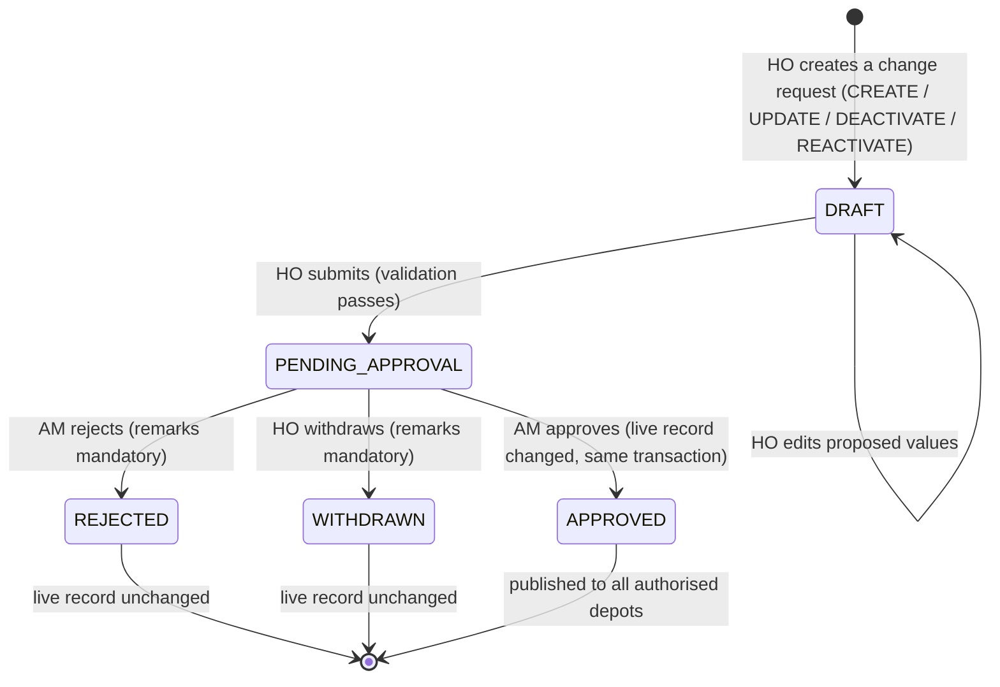
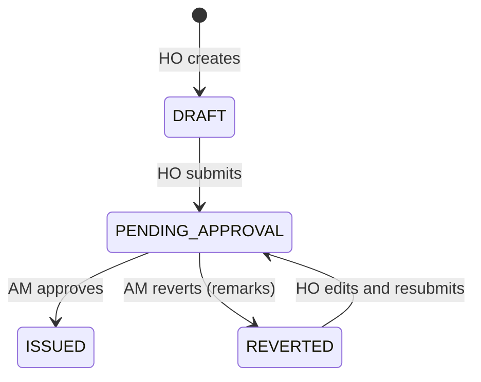
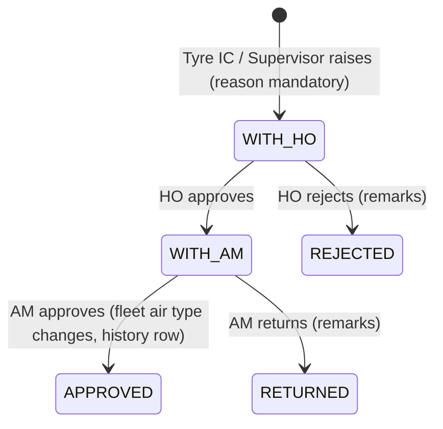
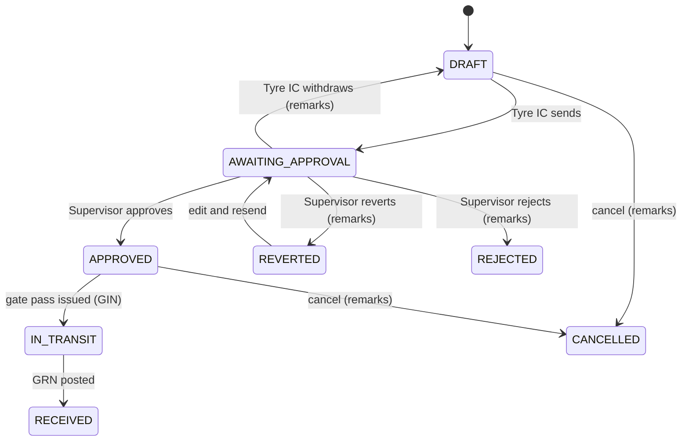
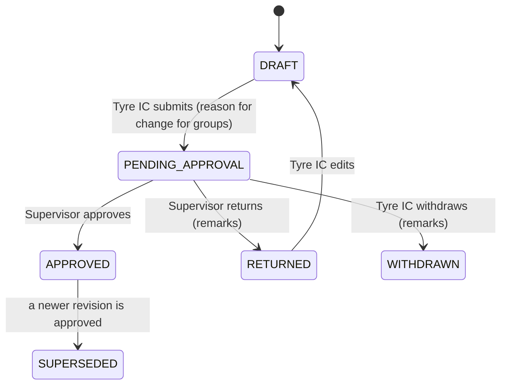
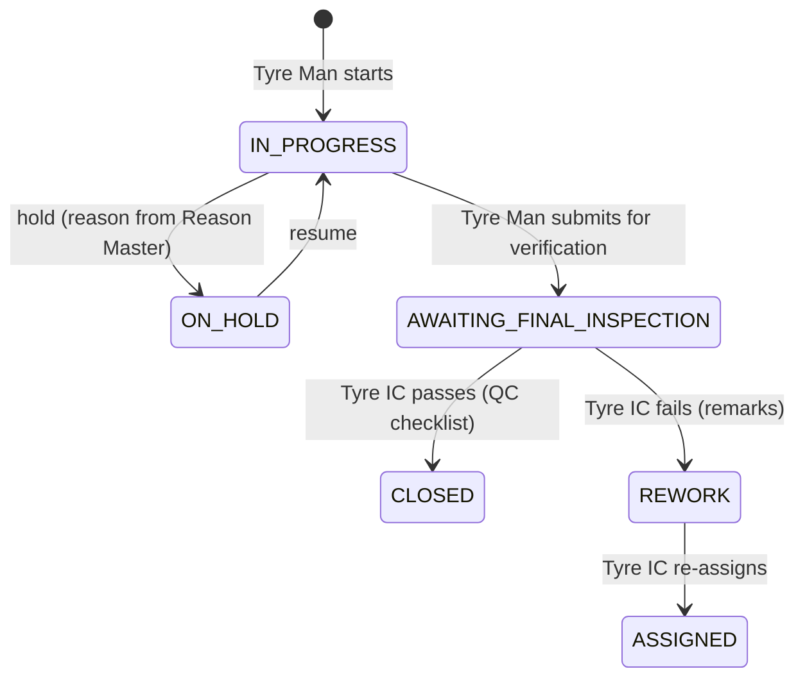

# Stage 2 — Approval Workflows

> **Stage 2.1 amendments (your decisions, applied below):** (1) **27 master entity types** (adds `tyre_number_series`; `tyre` becomes *corrections only*, tyres themselves originate from Central Store receipts — `stage2.1-central-store-tyre-creation.md`). (2) **Withdrawal rule** (UQ-14): `DRAFT → PENDING_APPROVAL → WITHDRAWN`; only the submitting HO user or the service-role administrator; remarks mandatory; never after approval/rejection; original payload preserved — see rules R13–R17. (3) **Allocation** statuses use the prototype words and allocate individual tyres (OA-02). (4) AM approval of master data and operational approvals remain independent. Details of enforcement: `stage2.1-security-review.md` §4.

Two independent approval systems, built on different tables, different functions and different queues:

| | A. Master-data approval | B. Operational approval |
|---|---|---|
| Hierarchy | HO (Tech) → AM (Tech) | Workflow-specific (Supervisor, AM, HO, Tyre IC) |
| What it controls | Changes to **master records** | Business **documents and requests** moving through their lifecycle |
| Proposed change stored | In `master_change_requests` (JSON), live row untouched | The document itself carries a status; some keep **revisions** |
| Statuses | `DRAFT → PENDING_APPROVAL → APPROVED / REJECTED` (+ `WITHDRAWN`, UQ-14) | Per workflow (prototype vocabulary) |
| Decider config | Fixed: AM only | `approval_routes` table, one row per allowed transition |
| Reason required | Reject, withdraw | Return, revert, reject, cancel, withdraw, remove |

---

## A. Master-data approval (HO → AM)

### A.1 Scope — everything HO manages
All of these follow the new rule, including the five that were direct in the prototype: **create, modify, deactivate, reactivate**.

| # | `entity_type` | Master (prototype screen) | Child rows carried in the same request |
|---|---|---|---|
| 1 | `org_unit` | Depots and organisational units (Depot Master) | — |
| 2 | `employee` | Tyre Man Register / employee master | — |
| 3 | `skill` | Skills (Maintenance Configuration → Skills) | — |
| 4 | `ref_value` | Reference lists (bus model types, vehicle types, axle types, product groups, categories, units, construction / tube types, removal reasons, vendor categories, qualifications) | — |
| 5 | `tyre_size` | Tyre sizes (Fleet Type Master → Tyre Size) | — |
| 6 | `tyre_make` | Makes | — |
| 7 | `tyre_model` | Makers' models | — |
| 8 | `tyre_folio` | Tyre Folio | locations |
| 9 | `tyre_detail_column` | Tyre Detailed Master | — |
| 10 | `fleet` | Fleet Register (master attributes) | — |
| 11 | `fleet_type` | Fleet Type Master | tyre sizes per type |
| 12 | `route` | Routes | — |
| 13 | `tyre` | Tyre Stock — **corrections only** to an existing tyre (field whitelist, UQ-38); tyres are created by Central Store receipts, never by HO | — |
| 14 | `folio_stock_param` | Minimum / maximum stock per depot (UQ-17) | — |
| 15 | `maintenance_job` | Maintenance Configuration → Jobs | required skills |
| 16 | `maintenance_schedule` | Maintenance Configuration → Schedules | categories, group rules, checkpoints, checklist items, job mapping |
| 17 | `psi_norm` | PSI Norms | — |
| 18 | `rotation_discout_norm` | Rotation & Discout Norms | eligible grades |
| 19 | `expected_life_km` | Expected Life KM | — |
| 20 | `shift` | Shift Master | — |
| 21 | `complaint_type` | Tyre Complaint Master | required jobs |
| 22 | `reason` | Reason Master | usages |
| 23 | `reject_reason` | Reject Reason Master | — |
| 24 | `wear_pattern` | Wear Pattern Master | — |
| 25 | `qc_checklist` | QC Master | checklist items |
| 26 | `vendor` | **Vendor Master** (new) | contacts |
| 27 | `tyre_number_series` | MTC Tyre No series (Stage 2.1) | — |
| — | *(eligible grades)* | Not a separate type: carried as child rows of #18, so the registry has **27 entity types** (Stage 2.1) | — |

Not under this workflow (they are operations, not HO masters): Outsource Employees (Tyre IC, direct, with reasons), Fleet Groups (Supervisor workflow), skill *assignments* (Supervisor workflow), fleet operational state (status, odometer), tyre current state, and all transactions.

### A.2 State machine

- Withdrawal applies to a **PENDING_APPROVAL** request only (your decision). Abandoning a never-submitted draft is a proposed small extension (UQ-49).
- A rejected or withdrawn request is **closed and immutable**. To try again the maker clicks *Revise*, which creates a **new DRAFT** pre-filled from the closed one (`supersedes_request_id`). This keeps a clean history, matches the prototype's "Returned → edit → resubmit" experience, and conforms to your four-state spec.
- Only **one open request** (DRAFT or PENDING_APPROVAL) may exist per record at a time.
- Pending changes **never** modify live master data.

### A.3 Rules enforced in the database

| # | Rule |
|---|---|
| R1 | Only `HO` may create, edit, submit, withdraw. Only `AM` may approve/reject. Checked in each function, not in the UI. |
| R2 | `maker_id <> checker_id` — HO cannot approve own changes (also impossible by role, but checked anyway). |
| R3 | An approver cannot decide a request whose **subject** is their own employee record (relevant to `employee`). |
| R4 | Reject, withdraw: remarks required (`length(trim(remarks)) > 0`, check constraint on the history row). |
| R5 | Submit validates the proposed payload (required fields, enum values, foreign keys exist and are ACTIVE, uniqueness vs live data, no conflicting open request). The same validation re-runs at approval. |
| R6 | **Stale-base protection:** the request records `base_row_version`; if the live row changed since the proposal was drafted (for example another approved change) the approval fails with a conflict and the maker must revise. |
| R7 | **Atomic apply:** on approval, one transaction (a) re-validates, (b) writes the live row and child rows through the entity's apply function, (c) increments `row_version`, (d) sets request `APPROVED`, `checker_id`, `decided_at`, `applied_at`, (e) writes history and `audit_logs` with old/new JSON, (f) raises notifications. If any step fails nothing is applied. |
| R8 | **Deactivation is a soft delete:** `status = 'INACTIVE'`, `deactivated_at/by`. Historic transactions keep pointing at the record. Inactive masters disappear from pick-lists but stay readable. Whether deactivation is blocked when the record is in use is UQ-15. |
| R9 | **Reactivation** is its own request type and needs approval. |
| R10 | No client can `INSERT/UPDATE/DELETE` master tables directly; they have no write policies. Only the apply functions (security definer) write them. |
| R11 | Approved changes are visible to every authorised role immediately (masters are global; read access follows the role matrix). "Published to all authorised depots" therefore needs no copy step. |
| R13 | **Withdrawal authority:** only the user who submitted the request (`maker_id = auth.uid()`, still role HO), or the project administrator through a service-role-only function. No other HO user, no AM, no Supervisor. |
| R14 | **Mandatory remarks** on withdrawal (non-blank), enforced in the function and by a check constraint on the history row. |
| R15 | **Withdrawal is possible only from `PENDING_APPROVAL`.** After `APPROVED`, `REJECTED` or `WITHDRAWN` the status is terminal; a trigger blocks any later change. Approve and withdraw racing each other are serialised by a row lock — the first one wins, the second gets "no longer pending". |
| R16 | **Withdrawn requests never modify live data**; the submitted `proposed_payload` and the base snapshot are preserved unchanged (payload is immutable once submitted); the withdrawal is a status change plus an approval-history row (`WITHDRAW`, actor, role, `via` MAKER or ADMIN, remarks) and an audit-log entry. |
| R17 | **A request cannot be decided by someone it concerns:** an approver cannot approve/reject a change whose subject is their own employee record. |
| R12 | Bulk approve/reject of several requests is allowed (prototype has "Approve selected / Return selected"); each request is decided and audited individually. Confirm in UQ-16. |

### A.4 Data stored for each request

`master_change_requests`: request number, entity type, target record id (reserved at draft time for CREATE), action, status, **proposed payload (JSONB, includes child rows)**, **base snapshot** of the live record (for the before/after comparison), base row version, change summary, maker, submitted-at, checker, decided-at, decision remarks, applied-at, `supersedes_request_id`.
`master_change_request_history`: one row per transition (from, to, actor, role, action, remarks, timestamp).
The AM screen shows a **field-level diff** of `base_snapshot` vs `proposed_payload`.

### A.5 Database API (all `SECURITY DEFINER`, callable via RPC)

| Function | Caller | Effect |
|---|---|---|
| `master_request_create(entity_type, action, target_id, payload)` | HO | creates DRAFT, captures base snapshot |
| `master_request_update(request_id, payload)` | HO (owner, DRAFT only) | replaces payload |
| `master_request_submit(request_id)` | HO (owner) | validate → PENDING_APPROVAL |
| `master_request_withdraw(request_id, remarks)` | HO (owner, PENDING only) | → WITHDRAWN |
| `admin_withdraw_master_request(request_id, remarks)` | service role only (project administrator) | → WITHDRAWN with `via = ADMIN`; logged in `admin_action_log` |
| `master_request_approve(request_id, remarks?)` | AM | validate, apply, APPROVED |
| `master_request_reject(request_id, remarks)` | AM | → REJECTED |
| `master_request_revise(request_id)` | HO | new DRAFT from closed request |

Per-entity logic lives in `app.apply_<entity>(payload, action, actor)` functions registered in `master_entity_registry`.

### A.6 Interaction with prototype behaviour

| Prototype | Stage 2 behaviour |
|---|---|
| Draft → Pending approval → Approved → Published | Same; "Published" is implicit because masters are global (shown as "Live" with the approval date) |
| AE **Return** (reason) | AM **Reject** (remarks) |
| Maker **Withdraw** (reason) | Kept as `WITHDRAWN` (UQ-14) |
| HO **Delete** (Folio) | Replaced by Deactivate request |
| Directly-saved masters (Complaint, Reason, Fleet Type, Shift, norms, jobs, schedules, fleet edits) | **Now require approval** (your decision) |
| Reason Master "New reasons from depots → Add to list / Reject" | Depot suggestion → HO accepts → creates a `reason` CREATE request → AM approves (UQ-09). HO rejection of a suggestion needs remarks and does not involve AM. |
| Audit Trail modal | Built from `master_change_request_history` + `audit_logs` |

---

## B. Operational approvals

### B.1 How they work
Each operational document has its own status column. A transition is a call to a function (`op_transition(entity, id, action, remarks)` or a typed wrapper) that:
1. loads the allowed transition from **`approval_routes`** (workflow, from-status, action, to-status, `approver_role`, scope, remarks-required);
2. checks the caller's role and depot scope;
3. checks `actor <> maker` for approval-type actions;
4. rejects if remarks are required and missing;
5. updates the status, writes `document_status_history` (When / Who / Role / Action / Remarks — the prototype's history table) and `audit_logs`, and notifies the next actor.

Routes whose approver is not known have `approver_role = NULL` and `is_resolved = false`. The function **refuses** them, so nothing is invented; once you decide, the route is filled in with data, no code change.

### B.2 Workflow register

AE in the prototype has been mapped to **AM**. "Prototype evidence" points to the Stage 1 documents.

| ID | Workflow | Maker / raiser | Approver / decider | Actions (remarks mandatory marked ✱) | Prototype evidence | Status |
|---|---|---|---|---|---|---|
| OA-01 | **Purchase Indent** | HO | **AM** (was AE) | Approve · Revert ✱ | BR-AP-01, AE-10 | Resolved |
| OA-02 | **Allocation Request** (individual Central Store tyres → depots) | HO | **AM** (was AE) | Approve · Return ✱ · Withdraw ✱ (HO) | BR-AP-02; prototype runtime | Resolved from the prototype runtime (rule details UQ-37) |
| OA-03 | **Fleet air-type conversion** | Tyre IC or Supervisor | Step 1 **HO** review → Step 2 **AM** final | HO: Approve/forward · Reject ✱; AM: Approve · Return ✱ | BR-AP-03 | Resolved (HO step to confirm, UQ-07) |
| OA-04 | **GIN** | Tyre IC | **Supervisor** | Approve · Revert ✱ · Reject ✱ · Withdraw ✱ · Cancel ✱ | BR-AP-04 | Resolved |
| OA-05 | **Depot Indent / Internal Transfer indent** | Tyre IC | **Supervisor** | Approve · Revert ✱ · Reject ✱ · Withdraw ✱ · Cancel ✱ · Close ✱ | BR-AP-05 | Resolved |
| OA-06 | **Fleet Grouping** (group revision) | Tyre IC | **Supervisor** | Approve · Return ✱ · Withdraw ✱ | BR-AP-06 | Resolved |
| OA-07 | **Duty Roster** (weekly) | Tyre IC | **Supervisor** | Approve · Return ✱ | BR-AP-07 | Resolved |
| OA-08 | **Skill** addition | Tyre IC | **Supervisor** | Approve · Return ✱ · Withdraw ✱ | BR-AP-08 | Resolved |
| OA-09 | **WSR** (tube / flap / disc) | Tyre Man or Tyre IC | **Tyre IC** decides | Accept & issue · Reject ✱ · Cancel ✱ (raiser) | BR-AP-09 | Resolved |
| OA-10 | **Complaint triage** | Tyre Man / Supervisor (log sheet) / Tyre IC | **Tyre IC** | Approve (assign job) · Reject ✱ | BR-AP-10 | Resolved |
| OA-11 | **WSR Issue GIN** | system | none (auto) | — | BR-AP-17 | Resolved |
| OA-12 | **Indent acceptance by supplying depot** (Internal Transfer Request) | requesting depot | **Tyre IC of supplying depot** | Accept & create GIN · Reject ✱ | BR-ST-02 | Resolved (fulfilment step, not an approval chain) |
| OA-13 | **Depot reason suggestion** | Tyre IC / depot | **HO** | Add to list (→ master request, A) · Reject ✱ | BR-AP-14 | Resolved |
| OA-14 | **Job cancellation / hold / replace / reschedule** | Tyre IC | none (authority of Tyre IC) | Reason ✱ | BR-JB-08..10 | Resolved |
| OA-15 | **Final inspection (verification)** | Tyre Man submits | **Tyre IC** (your decision); Supervisor performing it is open | Pass · Fail → Rework | BR-JB-13/14 | Partly resolved (UQ-06) |
| OA-16 | **DRN** | Tyre IC | **UNRESOLVED** | Submit → Approved / Rejected ✱ | BR-AP-11 | **Open — UQ-01** |
| OA-17 | **Tyre Damage Report** | system/TRS request → Tyre IC fills | **UNRESOLVED** (statuses Pending approval / Approved / Returned / Report Received) | — | BR-AP-12 | **Open — UQ-02** |
| OA-18 | **Premature Failure Report** | Tyre IC | **UNRESOLVED** ("TRS IC" is not one of the five roles) | Report Raised → Pending TRS IC → Sent to TRS / Returned | BR-AP-13 | **Open — UQ-05** |
| OA-19 | **Shift change request** (Tyre Man) | Tyre Man | **UNRESOLVED** | Pending approval → ? | BR-AP-15 | **Open — UQ-03** |
| OA-20 | **Leave request** (Tyre Man) | Tyre Man | **UNRESOLVED** | Pending approval → ? | BR-AP-15 | **Open — UQ-03** |
| OA-21 | **Prepone / Postpone request** | Tyre Man | **UNRESOLVED** | Submit → ? | BR-AP-16 | **Open — UQ-04** |
| OA-22 | **Outsource employee removal** | Tyre IC | none (direct, reason ✱) | Remove ✱ | BR-WF-06 | Resolved (confirm UQ-17) |
| OA-23 | **Gate pass cancellation** | Tyre IC | none | Cancel ✱ | BR-ST-05 | Resolved |
| OA-24 | **Master-data change** | HO | **AM** | see section A | — | Resolved (separate system) |

For the unresolved ones, the tables and screens are still designed (statuses, requester, remarks fields); only the approver role and the post-approval effect are left empty in `approval_routes`.

### B.3 Workflow detail

**OA-01 Purchase Indent**

"Issued" is the prototype's word for an approved indent that goes to Central Store. Vendor linkage: lines may carry a suggested vendor (Vendor Master).

**OA-02 Allocation Request**

```mermaid
stateDiagram-v2
    [*] --> PENDING_APPROVAL: HO allocates specific Central Store tyres to depots and sends for approval
    PENDING_APPROVAL --> APPROVED: AM approves (goes to Central Store; depots see Ready to receive)
    PENDING_APPROVAL --> RETURNED: AM returns (remarks)
    PENDING_APPROVAL --> WITHDRAWN: HO withdraws (remarks)
    RETURNED --> PENDING_APPROVAL: HO edits and resends
    APPROVED --> [*]: depot GRN receives the tyres into Live Tyre Stock
```

**OA-03 Fleet air-type conversion (Regular ↔ Nitrogen)**

The final effect writes the air type to `fleet_operational_state` and a row in `fleet_air_type_changes`; it is **not** an HO master edit, so it does not use workflow A. (Confirm this reading: UQ-07.)

**OA-04 GIN and OA-05 Depot Indent** (Tyre IC → Supervisor)

Indents continue after approval: `SENT → ACCEPTED (or REJECTED) → PARTLY_ISSUED / ISSUED → IN_TRANSIT → PARTLY_RECEIVED / RECEIVED`, plus `CLOSED` (remarks). The supplying depot's Tyre IC sees `SENT` as "New".

**OA-06 Fleet Grouping, OA-07 Duty Roster, OA-08 Skill**

Groups and rosters are **revisioned**: the previously approved revision stays active until the new one is approved, so proposed changes never alter live schedules.

**OA-09 WSR** — `REQUESTED → ISSUED | PARTLY_ISSUED | REJECTED ✱ | CANCELLED ✱`. Issue creates the WSR Issue GIN automatically with no approval (OA-11).

**OA-10 Complaint** — `NEW → ASSIGNED → CLOSED | REJECTED ✱`.

**OA-15 Verification (final inspection)**

### B.4 Separation of the two systems

| Concern | Master approval | Operational approval |
|---|---|---|
| Tables | `master_change_requests`, `master_change_request_history` | document tables, `approval_routes`, `document_status_history` |
| Approver set | `AM` only | per route (AM, SUP, HO, TIC) |
| Queue view | `v_master_approval_queue` | `v_operational_approval_queue` (filtered by caller's routes and depot) |
| Effect of approval | rewrites a live master row | moves a document to its next status |
| Shared | only `audit_logs`, `notifications`, `attachments` |

The AM's inbox shows two separate tabs (*Master changes*, *Operational approvals*); the Supervisor sees only the operational tab. A Supervisor decision never changes master data, and an AM master approval never moves an operational document.

### B.5 Mandatory-remarks matrix

| Action | Remarks |
|---|---|
| Master reject / withdraw | Required |
| Purchase Indent revert; Allocation reject; Air-type reject/return | Required |
| GIN / Indent revert, reject, withdraw, cancel, close | Required |
| Group / roster / skill return, withdraw | Required |
| WSR reject / cancel; complaint reject | Required |
| Job hold, cancel, replace, reschedule, on-behalf entry | Required (reason) |
| Gate pass cancel; outsource employee removal | Required |
| Approve (any) | Optional |

Enforced by `CHECK` constraints on history tables and guards in each function.

### B.6 Notifications triggered
Submitted for approval → approver role/depot; decided → maker; job assigned → assignee; WSR issued → raiser; GIN approved → Tyre IC; incoming indent → supplying depot; final inspection pending → Tyre IC; rework → assignee; master change decided → HO. Stored in `notifications`; clicking opens the record.

### B.7 Audit
Every transition writes `audit_logs` (user, role, depot, action, table, record, old and new values, timestamp) in addition to the status history. `audit_logs` and history tables are append-only.
