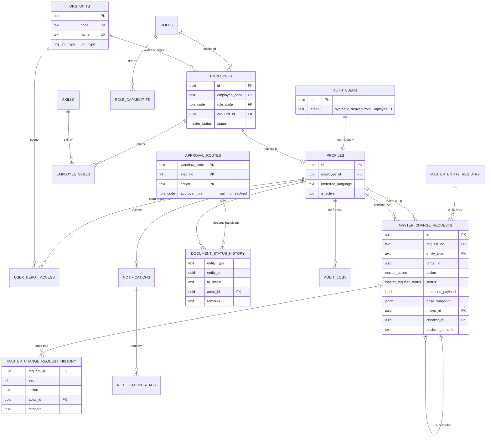
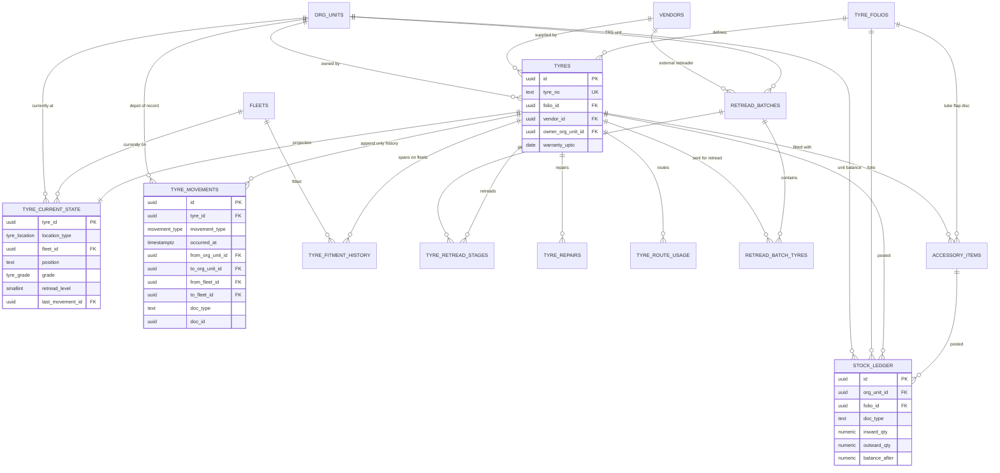
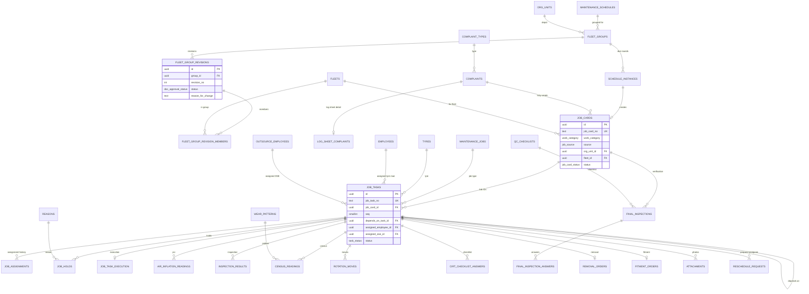
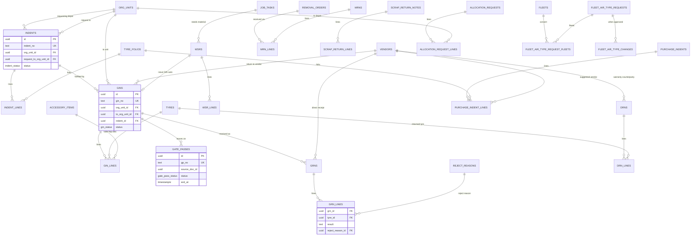
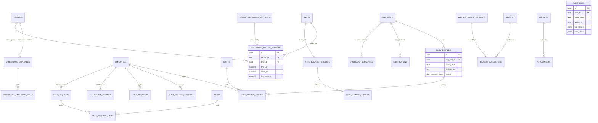

# Stage 2 — Entity Relationship Diagrams

> **Stage 2.1:** the 11 added tables (`depots`, `central_store_receipts`, `central_store_receipt_lots`, `tyre_number_series`, `allocation_request_tyres`, `tyre_ownership_history`, `tyre_identity_corrections`, `depot_tools_equipment`, `fleet_route_assignments`, `document_number_series`, `admin_action_log`) are drawn in the relationship diagram of `stage2.1-central-store-tyre-creation.md` §4.3 (receipts, tyres, allocation) and described in `stage2.1-table-justification.md` §10. `mrns`/`mrn_lines` in diagram 5 are now `grns`/`grn_lines` with `grn_kind = MRN`. The diagrams below otherwise stand.

Six Mermaid diagrams, one per domain, because a single diagram of 127 tables would be unreadable. Column-level detail is in `stage2-database-schema.md`. `||--o{` = one-to-many, `||--o|` = one-to-zero-or-one, `}o--o{` = many-to-many (shown through its join table in the diagrams).
Only the most important columns appear in each box. Standard audit columns (`created_at`, `updated_at`, `created_by`, `updated_by`) exist on every table and are omitted.

## 1. Identity, organisation, access and approval

`org_units` has 33 rows of type `DEPOT` plus TRS Chrompet, TRS Tondiarpet, Central Store and MIC Vehicle Unit (separate units, not depots).

## 2. Master data

```mermaid
erDiagram
    TYRE_MAKES ||--o{ TYRE_MODELS : has
    TYRE_MAKES ||--o{ TYRE_FOLIOS : make
    TYRE_MODELS ||--o{ TYRE_FOLIOS : model
    TYRE_SIZES ||--o{ TYRE_FOLIOS : size
    REF_VALUES ||--o{ TYRE_FOLIOS : "group, category, uom, construction, tube"
    TYRE_FOLIOS ||--o{ TYRE_FOLIO_LOCATIONS : "stocked at"
    FLEET_TYPES ||--o{ FLEET_TYPE_TYRE_SIZES : fits
    TYRE_SIZES ||--o{ FLEET_TYPE_TYRE_SIZES : size
    FLEET_TYPES ||--o{ FLEETS : "type of"
    ORG_UNITS ||--o{ FLEETS : "home depot"
    TYRE_SIZES ||--o{ FLEETS : "OEM size"
    FLEETS ||--|| FLEET_OPERATIONAL_STATE : "live state"
    FLEETS ||--o{ FLEET_DEPOT_HISTORY : "depot moves"
    FLEETS ||--o{ FLEET_STATUS_HISTORY : "status changes"
    FLEETS ||--o{ ODOMETER_READINGS : "odometer log"
    ROUTES ||--o{ FLEET_OPERATIONAL_STATE : "current route"
    TYRE_FOLIOS ||--o{ FOLIO_STOCK_PARAMS : "min max"
    ORG_UNITS ||--o{ FOLIO_STOCK_PARAMS : depot
    MAINTENANCE_JOBS ||--o{ MAINTENANCE_JOB_SKILLS : needs
    SKILLS ||--o{ MAINTENANCE_JOB_SKILLS : skill
    FLEET_TYPES ||--o{ MAINTENANCE_JOBS : "job for type"
    MAINTENANCE_JOBS ||--o{ MAINTENANCE_SCHEDULES : "scheduled job"
    MAINTENANCE_SCHEDULES ||--o{ SCHEDULE_CATEGORIES : contains
    SCHEDULE_CATEGORIES ||--o{ SCHEDULE_GROUP_RULES : rules
    SCHEDULE_CATEGORIES ||--o{ SCHEDULE_CHECKPOINTS : checkpoints
    SCHEDULE_CATEGORIES ||--o{ SCHEDULE_CHECKLIST_ITEMS : checklist
    SCHEDULE_CATEGORIES ||--o{ SCHEDULE_JOB_MAP : "job mapping"
    TYRE_FOLIOS ||--o{ SCHEDULE_GROUP_RULES : "folio rule"
    QC_CHECKLISTS ||--o{ QC_CHECKLIST_ITEMS : items
    TYRE_SIZES ||--o{ PSI_NORMS : size
    TYRE_SIZES ||--o{ EXPECTED_LIFE_KM : size
    ROTATION_DISCOUT_NORMS ||--o{ NORM_ELIGIBLE_GRADES : grades
    COMPLAINT_TYPES ||--o{ COMPLAINT_TYPE_JOBS : requires
    MAINTENANCE_JOBS ||--o{ COMPLAINT_TYPE_JOBS : job
    REASONS ||--o{ REASON_USAGES : "used for"
    REF_VALUES ||--o{ VENDORS : category
    VENDORS ||--o{ VENDOR_CONTACTS : contacts

    TYRE_FOLIOS {
        uuid id PK
        text folio_no UK
        text folio_name
        uuid make_id FK
        uuid tyre_size_id FK
        master_status status
        int row_version
    }
    FLEETS {
        uuid id PK
        text fleet_no UK
        text registration_no UK
        uuid org_unit_id FK
        uuid fleet_type_id FK
    }
    FLEET_OPERATIONAL_STATE {
        uuid fleet_id PK
        air_type air_type
        numeric live_odometer_km
        fleet_availability availability
    }
    VENDORS {
        uuid id PK
        text vendor_code UK
        text vendor_name
        uuid vendor_category_ref FK
        text gstin "fictional demo value"
        master_status status
    }
    MAINTENANCE_SCHEDULES {
        uuid id PK
        text schedule_code UK
        schedule_frequency_kind frequency_kind
        uuid job_id FK
    }
```

All tables in this diagram except the operational-state and history tables are **HO-managed masters** (change requests approved by AM).

## 3. Tyre inventory, movement and life history

`tyre_current_state` is a projection; `tyre_movements` is the permanent record, so moving a tyre never overwrites history.

## 4. Scheduling, job cards and execution

The Tyre Man's "My Jobs" is `job_tasks WHERE assigned_employee_id = me`, and RLS enforces the same.

## 5. Store documents, procurement and vendor links

## 6. Workforce, vendors in people/quality, reports and system

## 7. Tables with no foreign-key relationship

Three tables are deliberately free-standing and therefore not drawn: `tyre_detail_columns` (Tyre Detailed Master: attribute definitions), `application_settings` (key/value configuration) and `import_batches` (staging log for optional CSV import). Every other one of the 127 tables appears in at least one diagram above.

## 8. Cardinality notes worth checking

| Relationship | Rule |
|---|---|
| Employee ↔ Profile | 0..1 login per employee; Outsource employees never have profiles |
| Fleet ↔ Fleet group (per schedule) | A fleet is in at most one active group per schedule |
| Tyre ↔ open fitment span | At most one open span |
| Master record ↔ open change request | At most one DRAFT / PENDING request |
| Job card ↔ Job tasks | 1..n; Tyre Changing = 4, Rotation = 2, Census = one per tyre, Air Inflation / Inspection = one per fleet |
| Indent ↔ GIN | 1..n (partial issues) |
| GIN ↔ Gate pass | 0..n (cancel and re-issue allowed) |
| Tyre ↔ Movements | 1..n, append-only |
