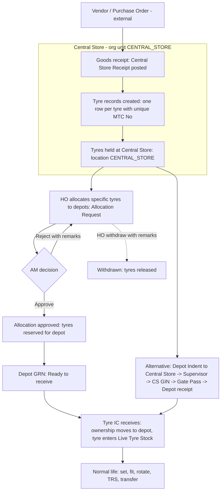
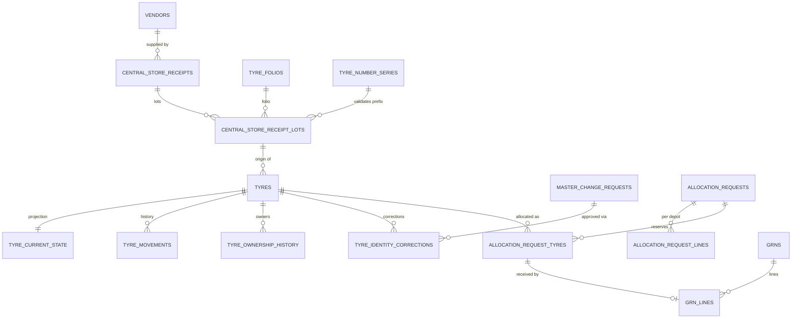

# Stage 2.1 — Central Store Tyre Creation

Implements your decision on UQ-10: **individual tyre records originate from Central Store goods receipt; HO (Tech) can only request corrections, which follow HO → AM approval.**
Design only. No tables, functions or data exist yet.

---

## 1. What the prototype actually shows

I re-read the prototype specifically for the Central Store receipt process. Evidence, with its limits:

| # | Evidence (prototype) | Where | What it tells us |
|---|---|---|---|
| E1 | **"New Tyres in Stock"** window — "Central Store arrivals, unallocated to allocated". Per-tyre list: Folio ID, Folio Name, Specification, **MTC No**, **Manufacturer No**, **Received** date, **Rate**, status (Unallocated / Pending approval / Allocated), Allocated To, Request No. KPIs: New Tyres · Unallocated · Pending Approval · Allocated | HO/AE Allocation Requests → *Stock* | Individual new tyres, each already with an MTC No and a Manufacturer No, exist at Central Store **before** any depot gets them |
| E2 | The stock is held as **lots**: tyre-number **prefix** + serial range, manufacturer-number **prefix**, make, model, size, construction, tube type, folio, **rate**, **received date**. Example: prefix `SS`, serials 305–356, make JK Win Energy XM3, 7.50 X 16, folio F7001, ₹16,800, received 22-09-2026; MTC No = prefix + 4-digit serial (`SS0305`), Manufacturer No = maker prefix + 6-digit serial | allocation data | Receipts arrive in lots; each tyre in a lot gets a number from a running serial |
| E3 | A per-size **series** record `{prefix, last serial, balance}` (7.50 X 16 → `SS`; 10.00 X 20 → `RT`; 295/80R22.5 → `RM`) | allocation data | MTC tyre numbers are 2-letter prefix + 4-digit serial, with a prefix per tyre family. (Other prefixes also appear in the tyre register, e.g. `QS`, `RS`, `UN`, `EX`, so the full series list is **not** known.) |
| E4 | **Allocate New Tyres** (HO): Size *, Allocation Type (New Tyre Allocation, Additional Allocation, Re-allocation, Emergency Allocation), per-depot quantities (depots grouped under five "hubs"), *Split Equally*, *Clear*. Validation: "Select a size"; "No unallocated tyres of this size"; "Enter a quantity for at least one depot"; **"Total must equal N new tyres"** — the quantities must use *all* unallocated tyres of that size. The system picks the specific tyres in number order | HO Allocation Requests | Allocation is by individual tyre, sequentially; the all-or-nothing rule is a prototype validation to confirm (UQ-37) |
| E5 | Allocation request `AR-001…` statuses **Pending approval → Approved / Returned (reason) / Withdrawn (reason)**; Approve text: *"Approve this allocation request? It goes to Central Store."* | HO and AE | HO → AM approval (AE → AM); withdraw and return need reasons |
| E6 | After approval the **depot's GRN screen** shows a row: Source *Central Store*, Against *AR-nnn / HO Allocation*, status **Ready to receive**. *Receive* opens "Receive — AR-nnn: Against HO Allocation, From Central Store, To Mandaveli Depot, Tyres N" with the tyre list (MTC No, Manufacturer No, Folio, Make, Model, Size, Construction, Tube Type, **Manufactured Date**, **Warranty Upto**). Result: a GRN `GRN-MN-IN-nnnn` is made and **"N new tyres added to Live Tyre Stock"** | Tyre IC GRN | The tyre enters a depot's stock by **GRN against an allocation** |
| E7 | **Indent route**: a Depot Indent addressed to Central Store → Supervisor approves → "Accepted by Central Store · converted to `GIN-CS-2026-0412`" → "dispatched" → inward **Gate Pass** (type *Central Store GIN (Inward)*) → depot receipt; partial: "Partly received — `GIN-CS-2026-0412` · 8 of 12" | Supervisor/Tyre IC audit logs, Gate Pass | Second way tyres, tubes, flaps reach a depot from Central Store |
| E8 | Tyre **ledger** line: `ICRN-MN-2026-0230 · 26 May 2025 09:00 · Inward · Qty 1 · Balance 1 · "Received from Central Store"`, followed by `GIN-MN-2026-1630 · Outward · "WSR Issue GIN · Against WSR-… · J0264 · FR"`. The tyre drawer also shows an **"ICRN Number"** (`ICRN2601000000`) | Tyre Register / Tyre life drawer | At the depot, receipt from Central Store is recorded with an **ICRN**. The prototype never explains the abbreviation, and there are two formats |
| E9 | Tyre life **phases**: *Purchased* → *Idle / Live stock* → *Fitted*, with the first phase remarks "Received at Central Store — Mandaveli Depot" | Tyre life drawer | Origin and purchase are recorded as the first lifecycle phase |
| E10 | Tyre attributes: Makers No, MTC No, Received date, Purchase date, Manufactured Date, Warranty Upto, Folio, Make, Model, Size, Ply… | Tyre Register | The fields a receipt must capture |
| E11 | Purchase Indent grid: "Order Qty", "Receive Qty", "Pending PO", "Prev PO No / Date", reference `PO-2026-1848` | HO/AE Purchase Indent | Purchase orders and receipts exist **outside** the prototype |

### What is *not* in the prototype
1. **The Central Store goods-receipt screen itself** — receiving tyres from a supplier, entering lots, assigning numbers. Arrivals already exist when the Allocation screens open.
2. **Who operates Central Store.** None of the five roles is Central Store staff.
3. **A Central Store document number** for the receipt (a "CS GRN").
4. **Vendor, invoice, challan or PO fields** on tyres.
5. **The meaning of ICRN**, and whether ICRN or GRN is the depot's receipt of Central Store goods (both appear).
6. **A rule for MTC Nos** beyond "prefix + 4 digits" and the three prefixes above.
7. The dates in the allocation demo (purchase = received − 20 days; manufactured = purchase − 25 days; warranty = manufactured + 3 years) are **generated by the prototype's demo code**, not business rules. They are not carried into the design.

These are listed as questions UQ-33 … UQ-38 (`stage2-unresolved-business-questions.md`). The design below follows your decision and the evidence, and leaves the unknown parts configurable or switched off. Nothing is invented as a final format.

---

## 2. Target process

Two inbound routes from Central Store to a depot exist in the prototype (allocation, and indent→GIN-CS). Both end with a depot GRN/receipt and a ledger entry; both operate on **individual, already-created tyres** (and, for the indent route, on tubes/flaps/discs).

## 3. Rules (your decision, made precise)

| # | Rule | Enforcement |
|---|---|---|
| T1 | **Every tyre originates from a Central Store receipt.** There is no insert path into `tyres` except the posting function. | No INSERT policy on `tyres`; `tyres.origin_receipt_lot_id` is `NOT NULL` with a foreign key; posting function is the only writer |
| T2 | **Unique identification.** `tyres.tyre_no` (MTC No) is globally unique; `(make_id, makers_no)` is unique where present. Both are validated at posting; duplicates abort the whole receipt | Unique index and partial unique index; function re-checks and returns the clashing numbers |
| T3 | **Origin and receipt history are retained.** Each tyre keeps its origin receipt lot (vendor, PO/invoice reference, received date, rate, receipt document). Later events are appended to `tyre_movements` and `tyre_ownership_history` | FK to the lot; append-only tables |
| T4 | **No overwrite of history.** Movements, ownership changes and identity corrections are new rows. The original tyre row and receipt remain untouched; identity corrections are recorded as before/after pairs | Append-only triggers; correction table |
| T5 | **Tyres move through authorised processes only.** Allocation, indent/GIN, gate pass, GRN, TRS, MIC, fitment — each through a function that checks role, depot and state | Existing workflows; `tyre_current_state` writable only by `app.post_tyre_movement()` |
| T6 | **HO may request corrections, never overwrite.** A correction is a `tyre` change request (workflow A: DRAFT → PENDING_APPROVAL → APPROVED / REJECTED, AM approves, remarks on reject/withdraw) | `master_entity_registry` entity `tyre`; apply function writes only the permitted fields and logs before/after |
| T7 | **Pending corrections do not alter the live tyre.** The proposal is stored in `master_change_requests`; the tyre keeps its original values until approval | Same engine as all masters |
| T8 | **After approval the original is still reconstructable.** Old values are stored in `tyre_identity_corrections`; if the MTC No itself was corrected, the old number remains searchable as an alias | Append-only table; alias lookup view |
| T9 | **Receipt cannot be silently edited.** A posted receipt is immutable. Mistakes are fixed by a *reversal* (while no tyre has left Central Store) or by correction requests | Status `POSTED`; trigger blocks updates; reversal function checks that all its tyres are still `CENTRAL_STORE` and unallocated |
| T10 | **Allocation reserves individual tyres.** A tyre can be in at most one open allocation. Releasing (withdraw/return/reject) frees it | Partial unique index on `allocation_request_tyres(tyre_id)` for open requests |

## 4. Data model changes

### 4.1 New tables

| Table | Purpose | Key columns |
|---|---|---|
| `central_store_receipts` (DEP; owner = Central Store) | Goods receipt header | `receipt_no` (format UNRESOLVED, UQ-35), `receipt_type` (`PURCHASE_RECEIPT`, `OPENING_BALANCE`), `vendor_id →vendors`, `po_reference text` (external PO such as `PO-2026-1848`), `invoice_reference text`, `challan_reference text`, `received_at timestamptz` (business time), `status` (`DRAFT`, `POSTED`, `REVERSED`), `posted_by`, `posted_at`, `reversal_remarks`, `remarks` |
| `central_store_receipt_lots` | One lot = one folio, a consecutive range or an explicit list of tyres | `receipt_id`, `folio_id`, `quantity`, `tyre_no_prefix`, `serial_from`, `serial_to` (or explicit list in `tyre_nos text[]`), `maker_no_prefix`, `maker_serial_from`, `maker_serial_to` (or `maker_nos text[]`), `unit_rate numeric(14,2)`, `purchase_date`, `manufactured_date`, `warranty_upto`, `batch_no` |
| `tyre_number_series` (MST, HO → AM) | Configured MTC Tyre No series | `prefix` (U), `tyre_size_id`, `serial_width smallint` (4), `description`, status. Used to **validate** supplied numbers; whether the system may *generate* numbers is UQ-34 |
| `allocation_request_tyres` | Individual tyres in an allocation | `allocation_line_id`/`request_id`, `tyre_id`, `to_org_unit_id`, `state` (`RESERVED`, `RELEASED`, `RECEIVED`), `grn_line_id` |
| `tyre_ownership_history` (APPEND) | Who owned the tyre when | `tyre_id`, `from_org_unit_id`, `to_org_unit_id`, `effective_at`, `reason` (`RECEIPT`, `ALLOCATION`, `TRANSFER`, `CORRECTION`), `doc_type`, `doc_id` |
| `tyre_identity_corrections` (APPEND) | Applied corrections | `tyre_id`, `field_name`, `old_value`, `new_value`, `change_request_id →master_change_requests`, `applied_at`, `applied_by` |

### 4.2 Changed tables
| Table | Change |
|---|---|
| `tyres` | add `origin_receipt_lot_id uuid NOT NULL →central_store_receipt_lots`; remove `registration_source`; `owner_org_unit_id` is the *current* owner (history in `tyre_ownership_history`) |
| `tyre_location` enum | add `CENTRAL_STORE` (tyres created there start in it) |
| `tyre_current_state` | add `reserved_for_allocation_id uuid`; location may be `CENTRAL_STORE` |
| `movement_type` enum | add `ALLOCATE`, `RELEASE_ALLOCATION` |
| `allocation_requests` | statuses become `PENDING_APPROVAL, APPROVED, RETURNED, WITHDRAWN` (prototype wording); `allocation_type` constrained to the four prototype values; `size` field replaced by tyre size on lines |
| `allocation_request_lines` | now the per-depot **summary** (`to_org_unit_id`, `qty`); the tyres are in `allocation_request_tyres` |
| `grns` / `grn_lines` | `source_kind` gains `ALLOCATION`; `allocation_request_id` and `allocation_request_tyre_id` links; line result for an allocation receipt (`ACCEPTED`/`REJECTED`) |
| `master_entity_registry` | adds `tyre_number_series`; `tyre` entity restricted to a **field whitelist** (section 6) |

### 4.3 Relationship summary

## 5. Secure database-side functions

All are `SECURITY DEFINER`, `search_path = ''`, executable only by `authenticated` (never `anon`), and perform their own checks. None is callable in a way that lets the browser choose identity, depot or numbers beyond what is validated.

| Function | Caller | Guards | Effects (one transaction) |
|---|---|---|---|
| `central_receipt_create(header)` / `central_receipt_add_lot(...)` | capability `central_receipt.post` (**unassigned**, UQ-33) | role/capability; receipt status DRAFT; folio ACTIVE and a *tyre* folio; vendor ACTIVE; numbers match an active `tyre_number_series`; no duplicates inside the lot | draft rows only |
| `central_receipt_post(receipt_id)` | same | status DRAFT; at least one lot; **locks the receipt row**; re-validates uniqueness against `tyres`; qty equals range or list length | creates one `tyres` row per tyre with `origin_receipt_lot_id`; `tyre_current_state` at `CENTRAL_STORE`; `tyre_movements` (RECEIPT); `tyre_ownership_history`; `stock_ledger` inward rows; `document_status_history`; `audit_logs`; document number via `app.next_doc_no` |
| `central_receipt_reverse(receipt_id, remarks)` | same + remarks | POSTED; every tyre still `CENTRAL_STORE`, never allocated | marks REVERSED, records reversing movements; tyres stay in the table (never deleted) as `status = INACTIVE` with reversal reference |
| `allocation_create/update/submit/withdraw/approve/return` | HO (create, submit, withdraw), AM (approve, return) | capabilities; HO ≠ AM; tyres must be `CENTRAL_STORE` and unreserved; row locks on the chosen tyres; remarks on withdraw/return; chosen tyres picked by number order unless HO selects (UQ-37) | reserves / releases tyres; status history; audit; notifications |
| `grn_receive_allocation(grn_id)` | Tyre IC of the destination depot | request APPROVED; destination = caller's depot; tyres RESERVED for that depot; not already received | per tyre: accepted/rejected; `tyre_movements` (RECEIVE_IN), ownership → depot, state → `LIVE_STOCK` (grade New, setting UNSET), `stock_ledger`, GRN number, allocation tyre state RECEIVED |
| `master_request_*` for entity `tyre` | HO (maker), AM (checker) | as workflow A, plus **field whitelist** and uniqueness checks on corrected numbers | on approval writes `tyres` fields, `tyre_identity_corrections`, alias, audit |

Because there is no other writer, **a tyre cannot exist without an origin receipt, cannot be duplicated, and cannot be edited directly.**

## 6. Corrections by HO (entity `tyre`)

Proposed whitelist (needs your confirmation, UQ-38):

| Field | Correctable? | Note |
|---|---|---|
| `makers_no` | Yes | unique per make; old value kept |
| `tyre_no` (MTC No) | Yes, with extra caution | must be unique and match a configured series; old number kept as alias; AM sees both values prominently |
| `folio_id` | Yes if the new folio has the same size | otherwise stock ledgers would misstate |
| `purchase_date`, `manufactured_date`, `warranty_upto` | Yes | |
| `vendor_id` | Yes | |
| Receipt rate / received date | **No** — belongs to the receipt; correcting requires a receipt reversal while untouched |
| Location, grade, owner, fleet, position, km | **No** — operational, changed only by movements |
| Origin receipt link | **No** |

## 7. Accessories (tube, flap, disc)
Prototype stock includes numbered tubes (`TB-1020-013`), flaps (`FP-16-001`) and discs (`DS-16-001`). Your decision names tyres only. The receipt design supports `item_kind` on lots so accessories can follow the same path later; whether they must is UQ-45. Until answered they remain as designed in Stage 2 (`accessory_items`).

## 8. Demo data under this rule
The one-month dataset obeys the same rule: **every demo tyre is created by a posted Central Store receipt** — historic receipts (`OPENING_BALANCE` or `PURCHASE_RECEIPT`, back-dated in business time) posted through the real function by the seed script. Mandaveli's 535 tyres come from a handful of lots; September 2026 includes the lots shown in the prototype (SS0305–SS0356, RT1005–RT1204, RM3504–RM3583), AR-001…AR-003 allocations and the matching depot GRNs. Receipts are fictional; vendors are fictional.

## 9. How this will be verified
| Check | Method (Stage 4/5b tests) |
|---|---|
| No client can insert/update/delete a tyre | direct DML as every role fails |
| Duplicate MTC No / makers no rejected | post two receipts with a clashing number; second aborts, nothing persists |
| Concurrent posting | 20 parallel receipts with overlapping ranges: exactly the non-overlapping ones succeed |
| Reservation | two allocations racing for the same tyres: one wins |
| HO cannot approve own correction; pending correction leaves tyre unchanged | workflow A tests with `tyre` entity |
| History intact | after correction, movements/ownership/original receipt unchanged; alias finds old number |
| Origin invariant | scan: `tyres` rows without origin = 0 |
