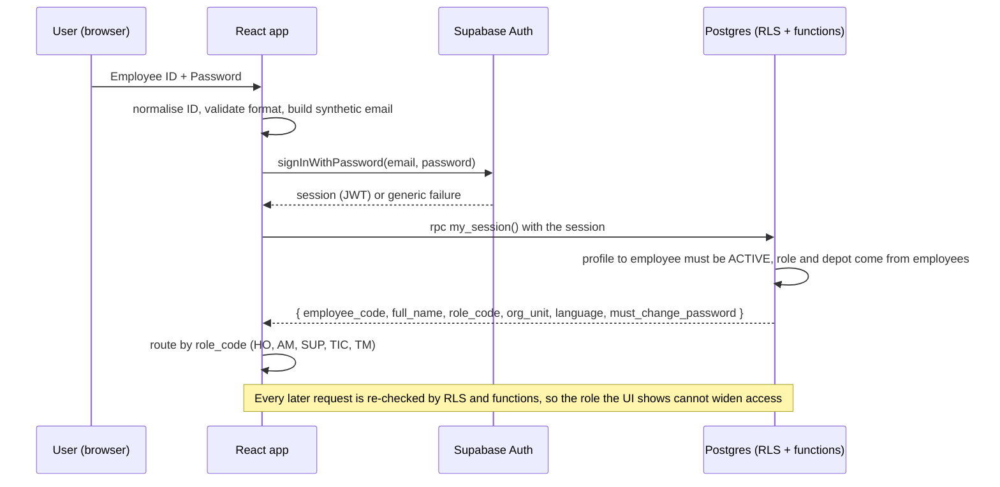

# Stage 2.1 — Employee ID Login and Account Administration

Implements UQ-11 (provisioning by a separate administrator script) and UQ-12 (synthetic-email mapping, tested with one account first).

**Nothing has been created or tested.** No Supabase user, project setting or script exists. The feasibility test described in §8 is a plan: you asked for it before bulk provisioning, and also asked that no demo users be created in this stage, so it waits for your explicit go-ahead and credentials (§8.1).

---

## 1. Principles

1. Users type **Employee ID + Password**. They never see or type an email address.
2. **Supabase Auth** does the actual authentication. The app never checks passwords itself.
3. **Passwords are never stored** by the application: not in tables, not in the frontend, not in logs, not in the repository. Supabase Auth stores only a salted hash.
4. The **project administrator is not an ERP role.** It is whoever holds the Supabase service-role key, acting outside the application through a local script. No row in `employees`, no `profiles` row, no ERP permissions.
5. There is **no public registration** and the browser can never create or modify an account.
6. **Role and depot come from the database**, from the approved employee record, never from the login form or JWT metadata that a user can edit.

## 2. Employee ID mapping

### 2.1 Rule
```
employee_code (stored)    e.g.  TIC-1147, AD-TM-01, HOT-AE-021
normalised ID             upper(trim(input))
auth email (derived)      lower(normalised ID) || '@' || <AUTH_EMAIL_DOMAIN>
                          e.g.  tic-1147@<domain>
```
- The mapping is deterministic and one-way in use: the app builds the email from what the user typed; no lookup table is exposed to the browser.
- `AUTH_EMAIL_DOMAIN` is configuration (front-end variable `VITE_AUTH_EMAIL_DOMAIN`, and the same value in the admin script). It is not a secret. The user never sees the resulting address.
- Allowed ID characters: letters, digits, hyphen. A database `CHECK (employee_code ~ '^[A-Z0-9]+(-[A-Z0-9]+)*$')` guarantees the derived local-part is a valid email local-part. All prototype IDs satisfy it.
- The login form validates the format before calling Auth, but treats any failure identically (see §3).

### 2.2 Candidate domains for the feasibility test
Supabase's email validation behaviour for non-deliverable domains is **not something I can assert without testing**. The test (§8) tries these in order and records the result; you choose from what works:

| Order | Candidate | Notes |
|---|---|---|
| 1 | A reserved/non-routable domain (for example one under `.invalid` or `.test`) | cleanest — no one can ever receive mail; may be rejected by the validator |
| 2 | A subdomain of a domain you control (for example `login.<your-domain>`) | will pass validation; set up no mailbox; mail is never sent because confirmation is disabled |
| 3 | A neutral public example domain | last resort; may be blocked |

## 3. Authentication process



- **No role selector** anywhere. A hand-edited role in the browser changes only what the UI draws; RLS still decides.
- **Generic failure message** for wrong ID, wrong password, inactive, banned or missing account: "Employee ID or password is incorrect."
- Wrong role/depot cannot be chosen at login; the Tyre Man app additionally refuses to open at desktop width (a UX rule, not a security control).
- **Session**: Supabase session with refresh; sign-out clears it. Inactive employees fail `my_session()`, so even a still-valid token yields no data.
- Rate limiting: Supabase's built-in Auth limits apply; the app adds a short client-side delay after repeated failures (courtesy only).
- Optional later: MFA for HO and AM.

## 4. Duplicate Employee ID prevention

| Layer | Mechanism |
|---|---|
| Employee master | `UNIQUE (employee_code)` and `UNIQUE (lower(employee_code))`; the code is **immutable** after creation (trigger) |
| No re-use | employees are never deleted (soft deactivation only), so a retired ID can never be issued to someone else |
| Auth | `auth.users.email` is unique; the email is derived from the code, so two accounts can never exist for one ID |
| Profile | `profiles.employee_id` is unique and `profiles.id = auth.users.id`; one login per employee |
| Provisioning script | refuses to create when the derived email or profile already exists; reports the clash instead of overwriting |
| Case/whitespace | normalised before comparison; `tic-1147` and `TIC-1147` are the same ID |
| Look-alikes | provisioning prints a warning when two IDs differ only by `0/O`, `1/I` characters |

## 5. Role and depot assignment validation

At **employee creation/change** (master workflow HO → AM) and again at **account creation** (script):

| Rule | Where enforced |
|---|---|
| `role_code` ∈ {HO, AM, SUP, TIC, TM} | enum / foreign key to `roles` |
| HO and AM have **no** depot; SUP, TIC, TM have exactly one depot | `CHECK` on `employees` |
| The depot is one of the 33 `depots` rows (not TRS, Central Store or MIC) | foreign key to `depots` |
| A depot has at most one active Tyre IC | partial unique index on (depot, TIC, ACTIVE) — to confirm, as the prototype shows one per depot |
| Tyre Men and Tyre IC in the same depot share the depot as their only scope | derived from `employees.org_unit_id` |
| Nobody changes their own role or depot | users have no write path to `employees` or `profiles`; changes go through master workflow, and an approver cannot decide a change about themselves |
| A login can exist only for an **ACTIVE** employee with `is_login_enabled = true` | script check + trigger on `profiles` |
| Account's `role` cannot be supplied by the script | the script passes only the employee code; the role is read from `employees` |
| Prototype IDs retained | employee codes such as `TIC-1147`, `TM-3092`, `HOT-0114`, `HOT-AE-021`, `SUP-2231` are used as-is |

A periodic **consistency report** (script `verify`) lists: auth users without profile, profiles without active employee, active login-enabled employees without account, duplicate emails, role/depot rule violations.

## 6. Password handling

| Topic | Design |
|---|---|
| Storage | Only inside Supabase Auth (hashed). Never in the app database, front end, repo, Netlify variables, logs or chat |
| Creation | Admin script generates a random password per account (high entropy), sends it to Supabase over TLS, prints it **once** to the administrator's terminal and never writes it to disk or logs. For a shared demo password, the administrator types it at an interactive prompt (not on the command line, so it stays out of shell history) |
| Policy | Minimum length and complexity set in the Supabase Auth settings; the script refuses weaker values |
| First login | Optional `profiles.must_change_password` flag; the app then forces `updateUser({ password })` (UQ-48, optional) |
| Self-service change | Allowed for the signed-in user through Auth; does not touch role/depot |
| **Reset** | Done by the administrator: `reset-password <code>` generates a new random password, sets it through the admin API, signs out all existing sessions of that user, and prints the password once. Email-based reset cannot work because synthetic addresses have no mailbox |
| Forgotten ID | Administrator looks up the employee record; IDs are not secret |

## 7. Deactivation

Two separate layers, deliberately:

1. **Employee deactivation** is a master-data change: HO proposes → AM approves (soft delete). On approval a database trigger sets `employees.status = INACTIVE` and `profiles.is_active = false`. From that moment `app.current_role()` returns NULL, so every RLS policy denies and `my_session()` fails — even if the user holds a valid token.
2. **Account lock** by the administrator script: `deactivate <code>` bans the Auth user (no new sessions, no refresh), signs out existing sessions, and records the action. `activate <code>` reverses it, but only if the employee is ACTIVE.

Emergency path: if an account must be blocked immediately without waiting for approval, the administrator uses (2) first; the employee record is then deactivated through the normal approval flow. Reactivation of an employee is also a master change.

## 8. Feasibility test with one account (before bulk provisioning)

### 8.1 What is needed (and why it is not done yet)
Stage 2.1 forbids creating demo users, and I have no Supabase credentials. The test therefore waits for: (a) your written go-ahead to create **one** test account; (b) the **publishable key** for the front end test; (c) the **service-role key** supplied only to the local admin script on the machine that runs it — **never pasted into this chat**; (d) your choice of who runs the test (you, or me guiding you).

### 8.2 Protocol
| Step | Action | Pass criterion |
|---|---|---|
| 0 | Confirm the target project ref is `hfvjhzxgehyiuuqtfntz`; confirm in dashboard that "Allow new users to sign up" is **off** and email confirmation is not required for admin-created users | settings match |
| 1 | Admin script creates **one** user for a throw-away ID (for example `TEST-0001`, not a prototype persona) using the first candidate domain, `email_confirm: true`, random password | API returns success; if it rejects the address, try candidate 2, then 3, recording each error |
| 2 | Verify no sign-up is possible from the browser (`signUp` call fails) | failure |
| 3 | `signInWithPassword` with the derived email | session returned |
| 4 | Wrong password and unknown ID | identical generic failure |
| 5 | Confirm the JWT carries no editable role; `user_metadata` is unused for authorisation | confirmed |
| 6 | Ban the user via the script; try to sign in and refresh | both fail |
| 7 | Reset password via the script; old password fails, new works; old session is revoked | confirmed |
| 8 | Remove the test user (admin API) and verify no residue in application tables | clean |
| 9 | Record: working domain, GoTrue version/behaviour notes, any rate-limit or validation findings | written into the Stage 3 report |

Bulk provisioning is designed **only after steps 1–7 pass**. If no domain works, the fallbacks are: (a) a domain you control (candidate 2), or (b) a thin Edge Function that authenticates the Employee ID server-side and exchanges it for a session — a larger design that I would bring back to you rather than adopt silently.

## 9. Administrator script — secure execution

### 9.1 What it is
A set of command-line tools in `supabase/admin/` (to be written in Stage 3) with commands: `create`, `create-bulk` (after the test), `deactivate`, `activate`, `reset-password`, `list`, `verify`, `set-demo-date`, `withdraw-master-request` (§10). It runs **only on the project owner's machine**.

### 9.2 Rules
| Rule | Detail |
|---|---|
| Never in React | The service-role key is not in `src/`, `public/`, Netlify settings or any `VITE_*` variable. A build-time check fails the build if a variable matching `service_role` or the key's pattern is found, and Stage 9 greps the production bundle |
| Where the key lives | Not in the repository. Read at run time from an environment variable set for the session, or from a local file listed in `.gitignore` (`.env.admin.local`) with owner-only permissions; or typed at a hidden prompt. Never printed |
| Wrong-project guard | The script requires the project URL and compares it with an expected value; it refuses to run if they differ |
| Confirmation | Destructive or bulk actions show a plan (`--dry-run` is the default) and require typing the number of accounts to proceed |
| No passwords in files or logs | Passwords printed once to the terminal; the audit log stores only that a password was set |
| Admin audit log | Every action writes `admin_action_log` (who ran it — free-text operator name, command, target employee code, outcome, timestamp, no secrets) through a database function executable only by the service role |
| Least privilege | Uses the key only for Auth admin API and the narrow SQL functions listed; no general SQL execution |
| Not in CI or hosting | Never executed on GitHub Actions or Netlify; the production deploy has no access to the key |
| Pre-commit protection | Secret-scanning rule in the repo (and `.gitignore`) to stop key files and `.env*` being committed |
| Key hygiene | If the key is ever pasted into chat, a ticket or a commit, rotate it immediately in the Supabase dashboard |
| Separate identity | The operator's identity is the Supabase project owner login, not an ERP account. Demo users get no administrator rights; there is no ERP screen that can create accounts |

### 9.3 Typical runs
```
admin create TIC-1147                      # creates account for an existing active employee; prints password once
admin reset-password TM-3092
admin deactivate AD-TM-02
admin verify                               # consistency report, read-only
admin set-demo-date 2026-09-20             # see architecture review: demo date
```
(Commands are design only; no script exists yet.)

## 10. Administrator override on master requests (UQ-14 link)
Your withdraw rule allows "an explicitly authorised administrator" to withdraw a pending request. Because the administrator is not an ERP role, this is exposed **only** as `admin_withdraw_master_request(request_id, remarks)`: executable by the service role alone, remarks mandatory, writes the approval history (`withdrawn_via = 'ADMIN'`) and `admin_action_log`. It cannot approve, reject or edit anything.

## 11. Demo accounts (after the test, in Stage 3)
- One account per prototype persona with the **retained employee IDs**: `HOT-0114` (HO), `HOT-AE-021` (AM), `SUP-2231`, `TIC-1147`, `TM-3092`.
- Further accounts per `stage2-mock-data-plan.md` (Tyre ICs, Supervisors, Tyre Men).
- All names are fictional and all records are marked demonstration data; none carries a real phone number.
- Passwords are generated at provisioning time; none appears in any document.
