# Workflow Documentation

> **Stage 2 update.** Superseded in part by `stage2-approval-workflows.md`. In particular: WF-01 now applies to **all** HO masters (Return → Reject with mandatory remarks; Deactivate/Reactivate are also requests); "AE" in every diagram means **AM (Tech)**; WF-06's final inspection is performed by the **Tyre IC** (Supervisor role open, UQ-06). Other workflows (WF-02 … WF-17) are retained as the operational baseline.

State diagrams use Mermaid (rendered by GitHub). Status names are the prototype's own. Tags such as `[INF]` mean the transition is inferred and needs your confirmation (see `business-rules.md`).

**Index**

| ID | Workflow | Actors |
|---|---|---|
| WF-01 | Master maker–checker | HO → AE |
| WF-02 | Purchase Indent | HO → AE |
| WF-03 | Allocation Request | HO → AE |
| WF-04 | Fleet air-type conversion | TIC/SUP → HO → AE |
| WF-05 | Fleet grouping and scheduled job generation | TIC → SUP |
| WF-06 | Job card lifecycle | TIC/SUP ↔ TM |
| WF-07 | Tyre Changing (Removal → Unsetting → Setting → Fitment) | TIC, TM |
| WF-08 | Air Inflation / Inspection / Rotation / Discout / Census rounds | TM |
| WF-09 | Complaint to job | TM/SUP/TIC |
| WF-10 | WSR (material request) | TM, TIC |
| WF-11 | Depot Indent → GIN → Gate Pass → GRN | TIC ↔ TIC, SUP |
| WF-12 | Retreading (TRS) cycle and "Goes To" | TIC, TRS |
| WF-13 | DRN | TIC |
| WF-14 | Premature Failure and Tyre Damage reports | TIC, TRS |
| WF-15 | Roster, skills, shift change, leave | TIC, SUP, TM |
| WF-16 | Reason suggestions from depots | Depot → HO |
| WF-17 | Notification flow | system |

---

## WF-01 Master maker–checker (Tyre Folio, Expected Life KM, Reject Reason, QC, Wear Pattern)

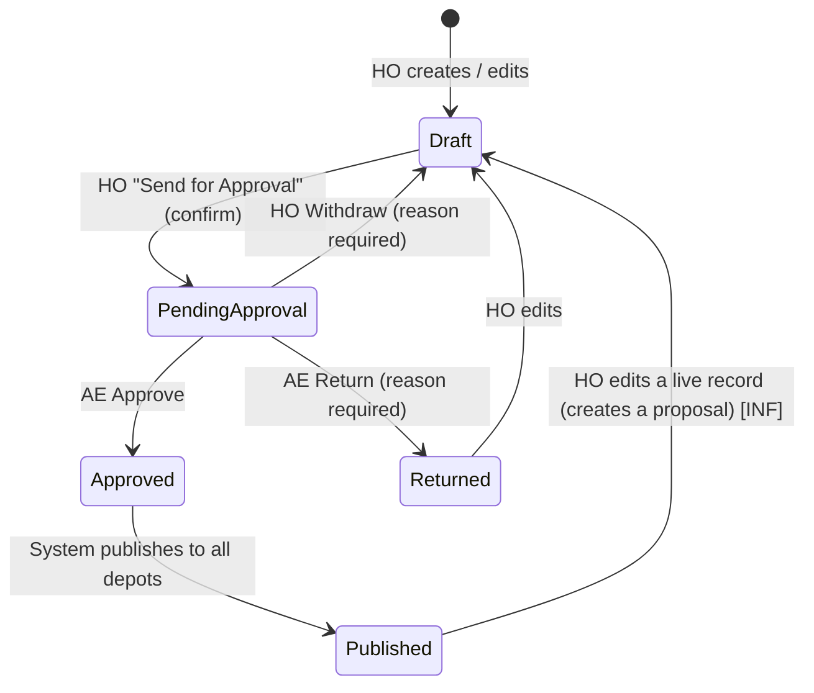

- Every transition writes an audit-trail event (actor, role, time, reason).
- AE can act on one row or many selected rows at once.
- **Rebuild rule:** while a change is pending, the *live* record is untouched; the proposed values wait in the approval request and are applied only on Approve (master-prompt requirement; the prototype implies it).

## WF-02 Purchase Indent

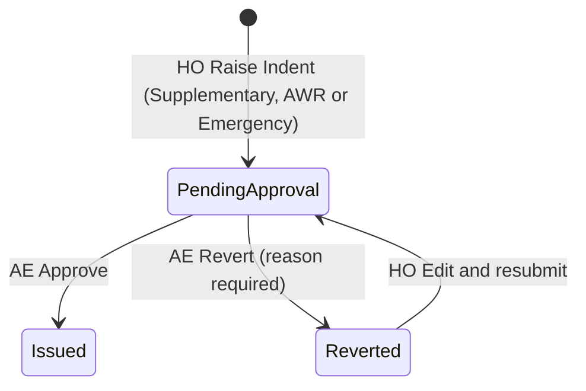

## WF-03 Allocation Request

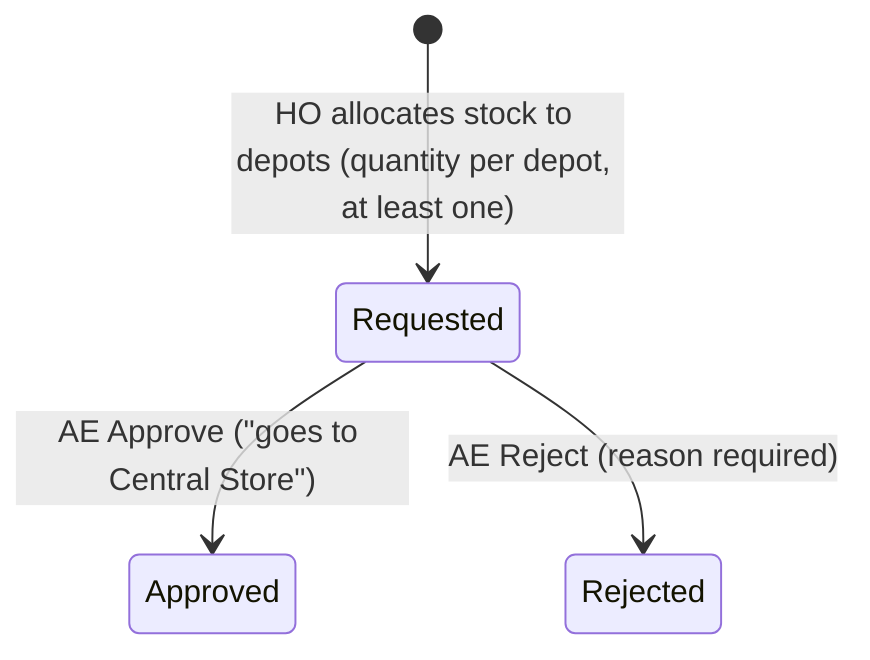
*Conf.: create/stock forms are not visible in the snapshot (C13).*

## WF-04 Fleet air-type conversion (Regular ↔ Nitrogen)

```mermaid
stateDiagram-v2
    [*] --> WithHO: TIC or SUP "Raise a conversion request" (fleets, convert-to, reason *)
    WithHO --> WithAE: HO Approve (HO can also Edit / Reject)
    WithHO --> Rejected: HO Reject
    WithAE --> Approved: AE Approve
    WithAE --> Returned: AE Return (reason required)
    Approved --> [*]: fleet Air Type changes; fleet joins matching air group [INF]
```

## WF-05 Fleet grouping and scheduled job generation

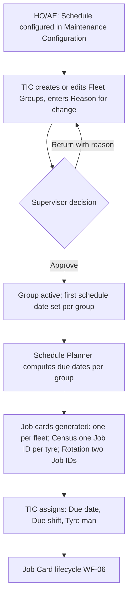
Withdraw (reason) is available to the TIC while pending.

## WF-06 Job card lifecycle

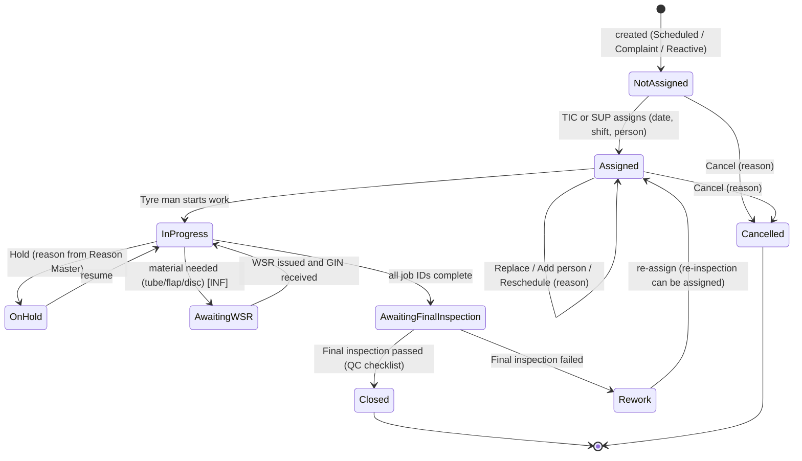
- TIC or SUP can enter the work **on behalf** of the tyre man (reason required).
- A held job cannot receive a new WSR until resumed.
- Fleet availability (In depot / Out / Breakdown / Held up) is tracked separately; Held up needs a reason.

## WF-07 Tyre Changing — four ordered Job IDs

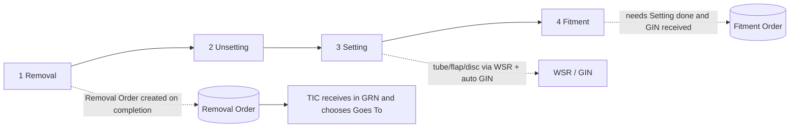

| Step | Who | Inputs | Result |
|---|---|---|---|
| Removal | assigned tyre man | Removed at, odometer, NSD at removal, tyre condition, photo | Tyre removed from position; Removal Order |
| Unsetting | assigned tyre man | tube/flap/disc disposition set by TIC (Live stock Good or Repair) | Tyre Unset; "stays in Repair (Ready for Transit)" |
| Setting | assigned tyre man | tyre from live stock (Good Unset), tube, flap, disc | Tyre Set (Live stock Good Set) |
| Fitment | assigned tyre man | fitment tyre (live stock Good Set), fitted at, pressure after fitment | Tyre on fleet; Fitment Order |

If no Set tyre is available: **"Set tyre not available"** raises a complaint and holds the job.

## WF-08 Rounds executed by the Tyre Man

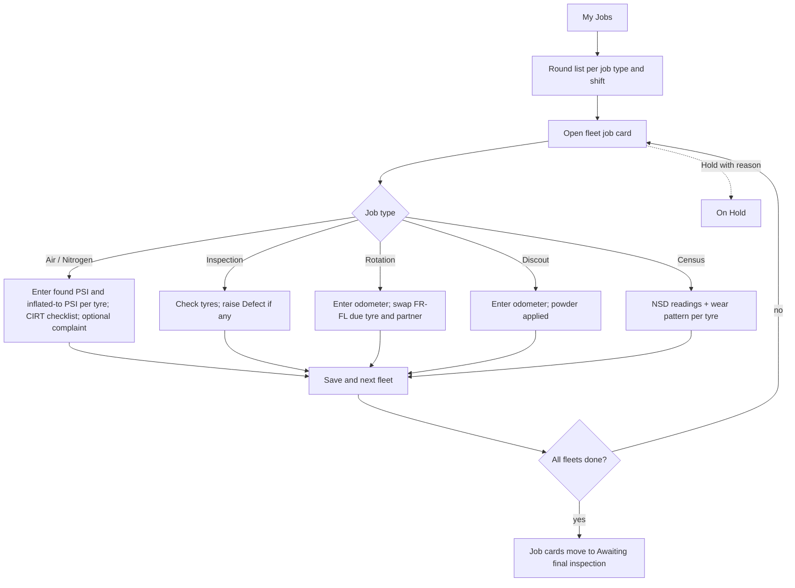
Pressure outside target −15 / +10 PSI is flagged as a PSI exception to the Tyre Incharge.

## WF-09 Complaint to job

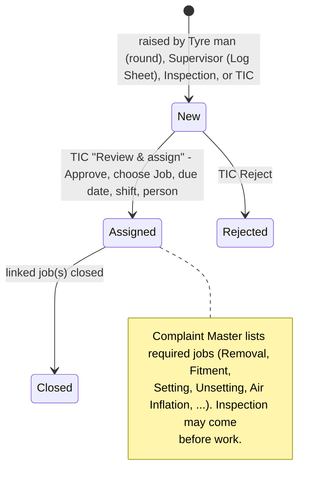
Sources: Air Inflation, Inspection, Log Sheet, Tyre Incharge. Suggested job codes come from the Complaint Master.

## WF-10 WSR (material request)

```mermaid
stateDiagram-v2
    [*] --> Requested: Tyre man or TIC raises WSR (tube / flap / disc by size)
    Requested --> Issued: TIC Accept and Issue (Item No per unit from live stock)
    Requested --> PartlyIssued: partial stock
    PartlyIssued --> Issued: balance issued [INF]
    Requested --> Rejected: TIC Reject (reason)
    Requested --> Cancelled: Cancel (reason)
    Issued --> [*]: WSR Issue GIN auto-created, no approval; tyre man Receive GIN
```

## WF-11 Depot Indent → GIN → Gate Pass → GRN (internal transfer)

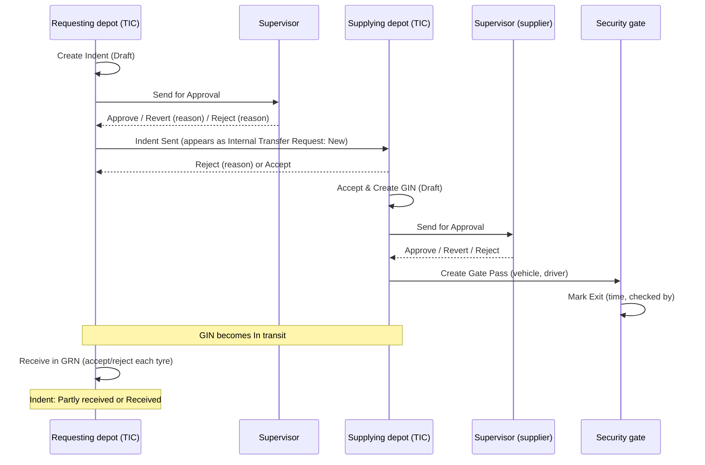
Indent statuses: Draft → Awaiting approval → (Reverted | Rejected | Sent) → New → Accepted → Partly issued / Issued → In transit → Partly received → Received; also Cancelled, Closed. GIN statuses: Draft → Awaiting approval → (Reverted | Rejected) | Approved → In transit → Received; Cancelled.

## WF-12 Retreading (TRS) cycle and "Goes To"

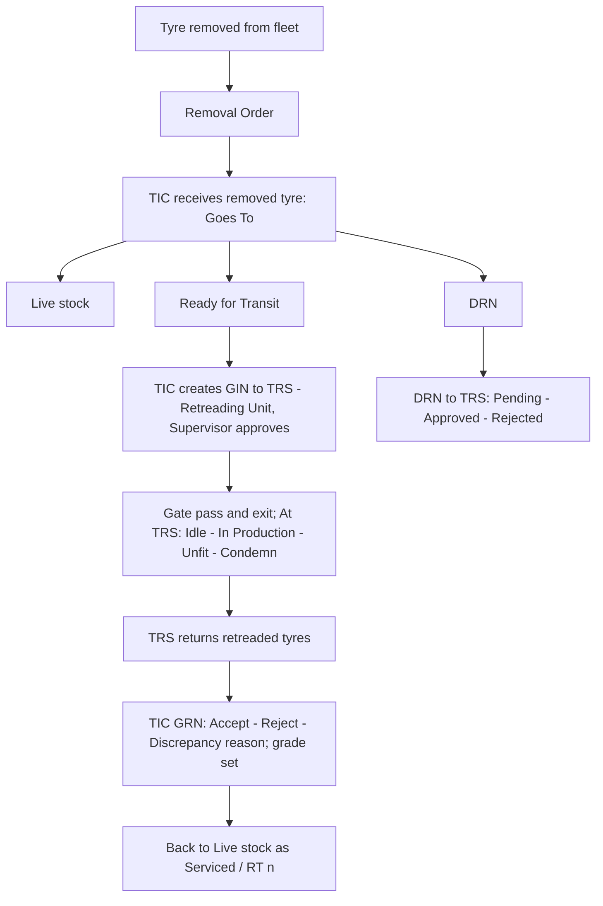
MIC vehicle tyres follow a parallel path (issue to MIC, return as Returned unused or Fitted on road).

## WF-13 DRN

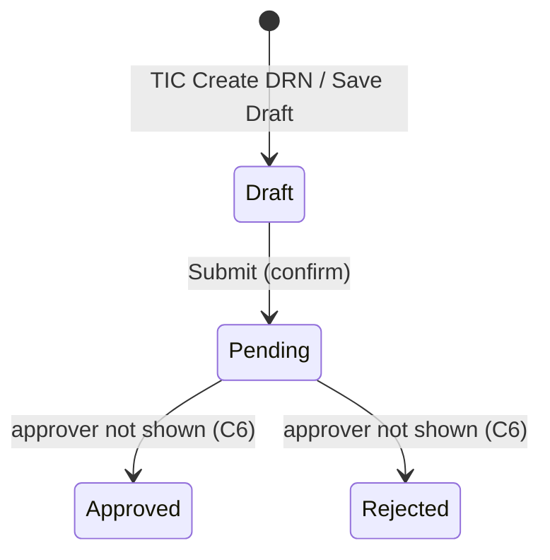

## WF-14 Premature Failure and Tyre Damage reports

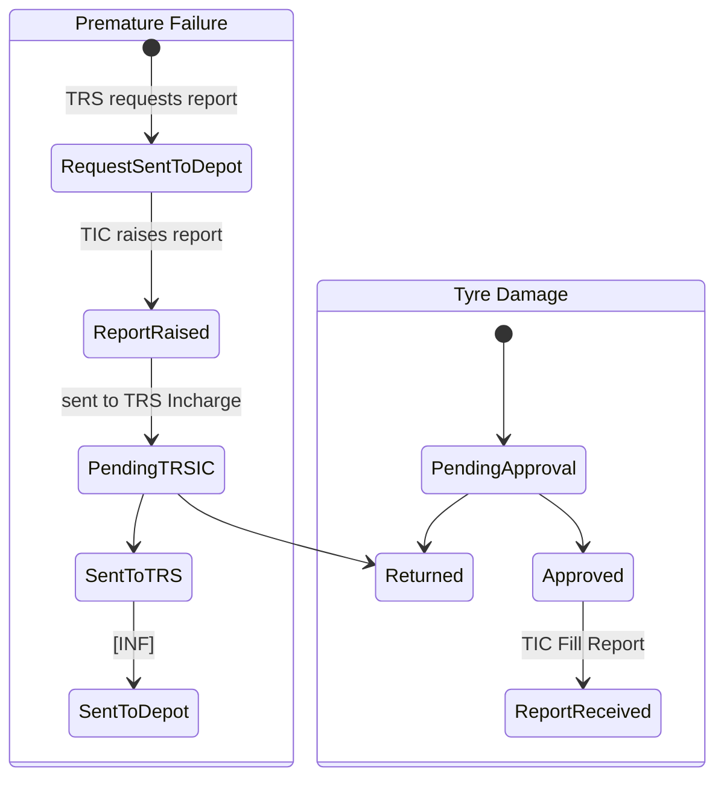
*Conf.: exact transitions and actors are only partly visible; the status vocabularies are from the data.*

## WF-15 Roster, skills, shift change and leave

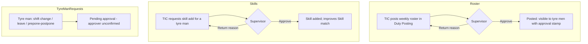
Attendance and week-off arrive from HRMS (read-only).

## WF-16 Reason suggestions from depots

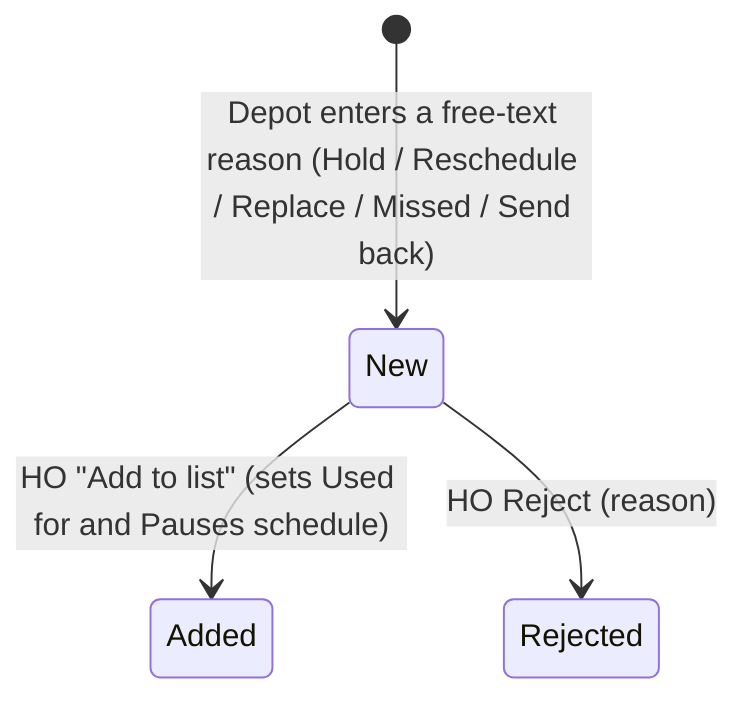

## WF-17 Notifications

Triggers observed: job assigned, WSR issued/approved, fitment waits for Setting, new complaint, indent received, final inspection pending, rework, GIN/indent returned, approvals pending (sidebar badges). Each notification stores type, reference, details, sender, time and a link to open. Detailed trigger matrix is a Stage 2 deliverable.
